<p align="center">
  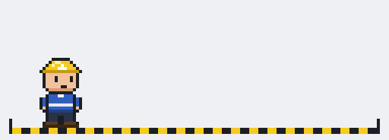
</p>

<p align="center">
  <i>Meet Gus. He checks every trial period, every skills gap and every training date, and still can't figure out who keeps stealing his stapler.</i>
</p>

<p align="center">
  <b>Constella</b> is a secure, AI-assisted HR platform. It turns a company's people, records and mail into a living galaxy<br>
  you can question, and an AI recruiting agent that ranks CVs by evidence. <b>Every answer is cited, every match explained,<br>
  and every action that touches a person waits for a human click.</b>
</p>

<p align="center">
  
  
  
  
  
  
  
  <br>
  
  
  
  
  
  
  
</p>

<p align="center">
  <a href="#the-30-second-version">30-second version</a> ·
  <a href="#the-problem">Problem</a> ·
  <a href="#what-constella-does">Product</a> ·
  <a href="#architecture">Architecture</a> ·
  <a href="#workforce-galaxy-1">Galaxy</a> ·
  <a href="#recruiting-agent-1">Recruiting agent</a> ·
  <a href="#explainability-with-xqdrant">XQdrant</a> ·
  <a href="#trust-by-design">Trust</a> ·
  <a href="#data-compliance--audit">Compliance</a> ·
  <a href="#evaluation-measured-not-promised">Evaluation</a> ·
  <a href="#run-it">Run it</a> ·
  <a href="#pitch-deck">Pitch deck</a> ·
  <a href="#team">Team</a>
</p>

---

## The 30-second version

| | |
|---|---|
| **Who it's for** | HR teams in companies of 50 to 500 people, too small for a big HR department, big enough that problems hide in the inbox. |
| **The pain** | HR spends about **32% of its time on email** (CIPD). The signals that predict burnout and departures are already in that mail, but nobody can see them. Replacing one employee costs **0.5 to 2× their salary** (Gallup). |
| **What we built** | A complete multi-tenant HR platform (employees, competencies, training, onboarding, surveys, e-signatures) plus two AI systems: the **Workforce Galaxy** (mail → explainable, cited insights) and the **Recruiting agent** (CV ranking by evidence, outreach, scheduling). |
| **Why it's different** | The AI is designed around its failure modes: **prompt injection** (two-layer defense), **bias** (protected attributes removed before any model reads a CV), **hallucination** (every claim must quote its source), **autonomy** (the agent has no send button). |
| **Proof** | **24/24 automated checks pass**: 16/16 injections caught, 0 false alarms, 15/15 personal details redacted, 14/14 counterfactual CVs identical, 0 unapproved sends, 0 double bookings, 0 duplicate emails. |
| **Compliance** | A **hash-chained, append-only audit trail** (computed by Postgres, verified independently, sealed), access logging on personal data, **GDPR requests** with a one-month clock, **retention** with dry run and legal holds, an Art. 30 **record of processing**. |
| **Golden rule** | ***The agent executes. The human decides about people.*** |

> **Pitch deck:** [constealla.vercel.app](https://constealla.vercel.app): 57 slides rendered live in three.js.

---

## The problem

Lucas runs HR for Aurora Industries: **142 people, 10 departments, ~3,500 emails a year**. On Monday at 08:12 he has 50 unread emails. Somewhere in them, a team on the assembly line is burning out, a new hire never got their check-in, and one polite email is trying to manipulate the company's AI assistant. He can't see any of it.

| Signal | Number | Source |
|---|---|---|
| Share of HR time spent on email | **32%** | CIPD |
| Employees engaged at work, worldwide | **20%** (lowest since 2020) | Gallup, *State of the Global Workplace* 2026 |
| Productivity lost to low engagement | **~$10 trillion**, ~9% of global GDP | Gallup |
| Cost of replacing one employee | **0.5 to 2× annual salary** | Gallup |
| Average cost per hire / median time to fill | **$5,475 / 44 days** | SHRM 2025 Recruiting Benchmarking |
| Time a recruiter gives a CV at first screen | **7.4 seconds** | Ladders eye-tracking study, 2018 |
| Top risk for LLM applications | **Prompt injection (LLM01)** | OWASP Top 10 for LLM Applications 2025 |
| One crafted email made Microsoft 365 Copilot leak data | **zero-click** | EchoLeak, CVE-2025-32711 |
| AI used in recruitment under the EU AI Act | **high-risk** (Annex III), obligations from **2 Dec 2027** | EU AI Act + Digital Omnibus |

**Plugging a chatbot into the HR inbox is exactly the wrong answer.** Every email and every CV is input written by someone outside your control. Constella is built the other way around.

---

## What Constella does

<table>
<tr>
<td width="33%" valign="top">

### HR core
The full, audit-ready HR system:
- Employees, org chart (PNG/PDF export)
- Job descriptions, skills, **competency matrix**, cross-skilling
- Training plan with hot/cold evaluations
- Onboarding / offboarding journeys with an **e-signed** trial sign-off
- Employee surveys (public links)
- Excel imports, dashboard, « Mon espace »

</td>
<td width="33%" valign="top">

### Workforce Galaxy
Company mail as a living 3D galaxy:
-  star = employee, cluster = department, beam = conversation
- **Signals** that explain themselves
- **Bridges** via betweenness centrality
- **Ask the galaxy**: cited, explained answers
- **Boîte RH**: the daily inbox digest
- Live ingest with **injection defense**

</td>
<td width="33%" valign="top">

### Recruiting agent
From CV pile to booked interview:
- **Pipeline 1**: guard → extract → two-tower retrieval → hard filters → LLM judge → **evidence check**
- **Pipeline 2**: drafts → **HR approval gate** → booking link → D1 reminder / D2 close
- Reply triage, slot locking, idempotent jobs
- 5-level **evaluation framework**

</td>
</tr>
</table>

<details>
<summary><b>Full module list (HR core)</b></summary>

- **Tableau de bord** (`/dashboard`): headcount, onboarding, competency coverage, upcoming training, trial periods ending, surveys (`GET /hr/dashboard`, one section per register the user can read).
- **Collaborateurs**: employees (`/hr/employees`), org chart (`/hr/org-chart`, PNG/PDF export), onboarding/offboarding plans (`/hr/journeys`, handover + account deactivation), Excel import (`/hr/import`).
- **Compétences**: skills, job descriptions (activities, required skills, onboarding template), competency matrix, competency dashboard, polyvalence.
- **Formations**: training plan, attendance, hot/cold evaluation links (`/f/<token>`), training dashboard.
- **Enquêtes** (`/hr/surveys`): survey builder, public link (`/e/<token>`), in-app answers, results.
- **Mon espace** (`/hr/me`): the member's own record, job description, competencies, training, onboarding, and the *Ask HR* panel.
- **Recrutement** (`/recruiting`): openings, criteria rubric, ranked candidates with evidence, interview slots, messages, approvals.
- **Galaxie RH** (`/hr/galaxy`) and **Boîte RH** (`/hr/inbox`).
- **Conformité** (`/compliance`): audit chain integrity and sealed export, GDPR access / erasure requests, retention policies, legal holds, record of processing.
- **Administration**: members, roles & permissions, departments & members, groups, visibility, organization, audit log, billing / license.

</details>

---

## Architecture

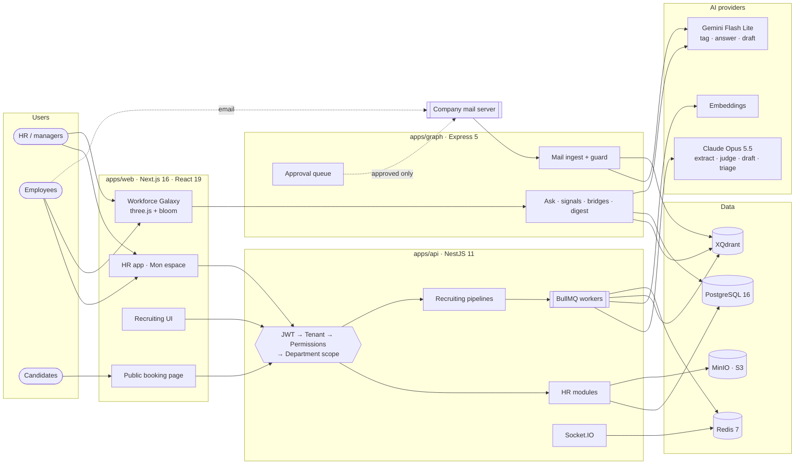

| Layer | Technology |
|---|---|
| **Web** | Next.js 16 (App Router), React 19, Tailwind v4, shadcn/ui, TanStack Query, Zustand, next-intl (FR default, EN), three.js / react-force-graph-3d |
| **API** | NestJS 11, Prisma 6, global guard chain, BullMQ workers, Socket.IO (`/ws`), throttling |
| **Graph service** | Express 5 + TypeScript, `pg`, Qdrant/XQdrant REST, Mailpit poller, Google AI Studio |
| **Data** | PostgreSQL 16 (52 Prisma models, audit chain triggers), Redis 7 (cache, pub/sub, queues), MinIO (S3 files), XQdrant (vectors + explanations) |
| **AI** | Claude Opus 5.5 with structured outputs (CV extraction, LLM judge, drafts, triage) · Gemini Flash Lite (mail tagging, answers, digest) · `gemini-embedding-001` / `text-embedding-3-small` |
| **Shared** | `@astro/shared`: permission catalogue (14 resources), 5 system roles, enums |
| **Ops** | Docker Compose (Caddy edge, N API replicas + worker, nightly encrypted backups), self-hosted bundle with offline license keys |

<details>
<summary><b>Monorepo layout</b></summary>

```
.
├── apps/
│   ├── api/                 NestJS API (:3011)
│   │   ├── prisma/          schema (52 models), migrations, seed
│   │   └── src/
│   │       ├── core/        tenancy, auth, rbac, department scope, history, audit log,
│   │       │                compliance, signatures, notifications, files, jobs, license …
│   │       └── modules/
│   │           ├── hr/          HR registers
│   │           ├── recruiting/  pipelines 1 & 2, guard, rules, outreach, eval/
│   │           └── platform/    plans, billing, super-admin
│   ├── graph/               Workforce Galaxy service (:3012): ingest, ask, graph, digest
│   └── web/                 Next.js app (:3010)
├── packages/shared/         permissions, roles, enums (built TS package)
├── docs/
│   ├── compliance/          data, compliance & audit: gap analysis and design
│   ├── graph/               Workforce Galaxy diagrams (.excalidraw + .png)
│   └── recruiting/          recruiting, XQdrant and evaluation diagrams
├── pitch/                   three.js pitch deck (static, no build)
├── deploy/                  self-hosted bundle
└── docker-compose.*.yml     dev and prod stacks
```

</details>

### Platform layer, audit-ready from day one

Constella was built on a mature, audit-ready platform layer from day one:

| Capability | How |
|---|---|
| **Multi-tenancy** | every tenant table carries `organizationId`, tenant picked with `X-Organization-Id`, explicit `deletedAt: null` filters |
| **RBAC** | `@RequirePermissions('resource:action')`, global guards JWT → Tenant → Permissions, 14 resources, 5 system roles + custom roles |
| **Department-scoped visibility** | managers see only their departments' employees, evaluations, journeys, job descriptions and trainings |
| **History & audit** | per-record modification history (with redaction) and a **tamper-evident** organization audit log: hash chain, seals, reads of personal data logged ([below](#data-compliance--audit)) |
| **E-signatures** | trial-period sign-off on onboarding journeys |
| **Notifications** | in-app + WebSocket (Socket.IO over Redis pub/sub) |
| **Billing & licensing** | plans, seats, invoices, super-admin console, self-hosted offline license keys |

---

## Workforce Galaxy

> Service: [`apps/graph`](apps/graph) · Diagrams: [`docs/graph`](docs/graph)

The whole workforce rendered as a 3D galaxy: each **star** is an employee (sized by seniority and activity), each **cluster** a department, each **beam** a conversation, with gold beams going to HR. You can fly through it, open anyone's file, replay a year month by month, and ask questions about a person, a selection, a department or the whole company.

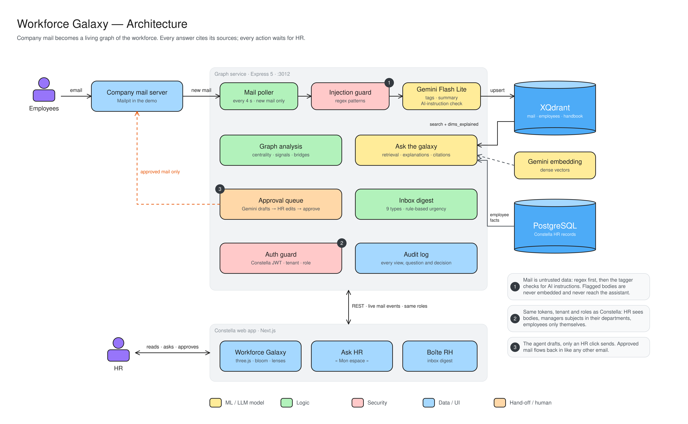

| Feature | What it does | Where |
|---|---|---|
| **Lenses** | departments, reporting lines, dominant topic, location | `galaxy-view.tsx` |
| **Timeline replay** | 12 months: hires appear, leavers fade, beams = last 3 months | `galaxy-view.tsx` |
| **Bridges** | betweenness centrality on work mail (HR excluded): *Camille connects Production to 5 departments* | `src/graph.ts` |
| **Signals** | 7 kinds, each with its reason (below) | `src/graph.ts` |
| **Ask the galaxy** | retrieval over mail + handbook, explained matches, one Gemini call, inline citations | `src/ask.ts` |
| **Ask HR** | the same engine in « Mon espace », restricted to the handbook + the employee's own file | `ask-hr.tsx` |
| **Boîte RH** | daily inbox digest: 9 types, rule-based urgency, cited AI overview | `src/digest.ts` |
| **Human in the loop** | Gemini drafts → HR edits → approve / reject; approved mail joins the graph | `/actions/*` |
| **Live ingest** | Mailpit poller every 4 s → guard → tag → embed → live beam + toast | `src/ingest.ts` |

<details open>
<summary><b>Live mail ingest: one email, two layers of injection defense</b></summary>

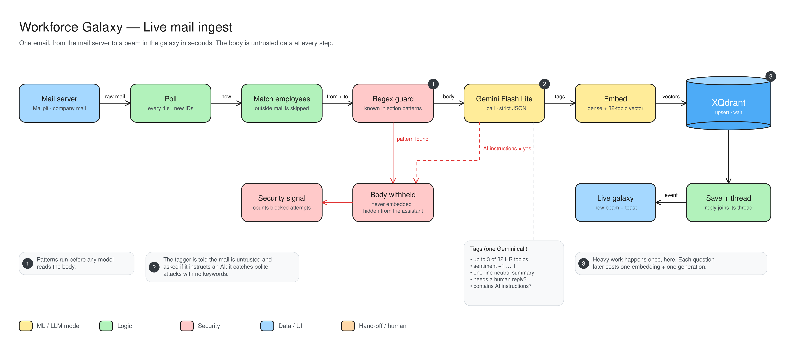

</details>

<details>
<summary><b>Ask, explained: scope first, one model call, every claim cited</b></summary>

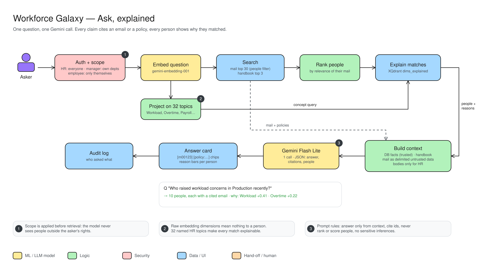

```text
Q  "Who raised workload concerns in Production recently?"
→  10 people, each with a cited email [m00123] …
   why: Workload +0.41 · Overtime +0.22
```

</details>

<details>
<summary><b>Signals, inbox digest and human in the loop</b></summary>

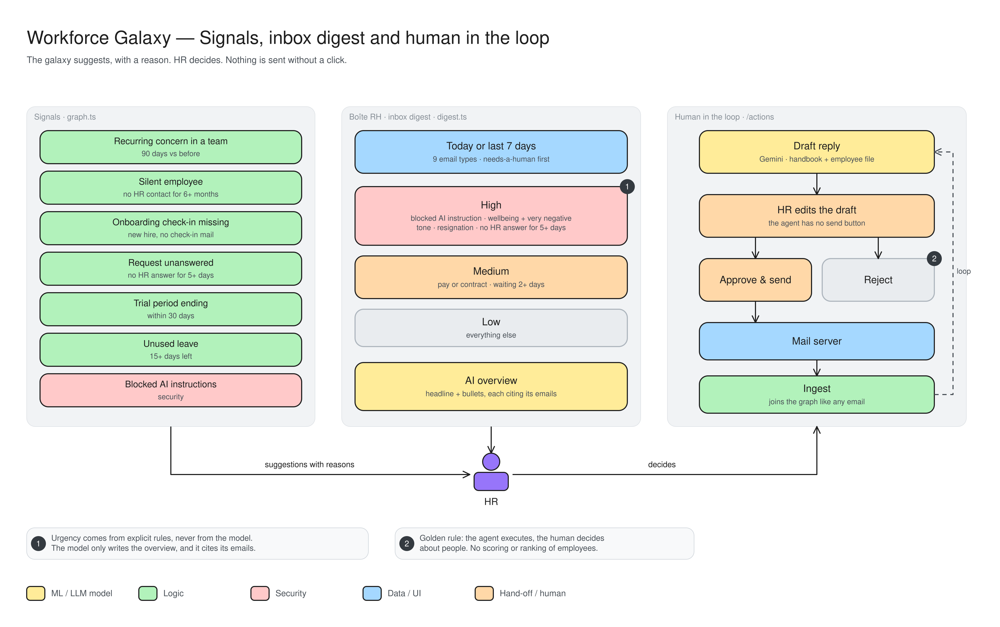

| Signal | Rule |
|---|---|
| Recurring concern in a team | workload / wellbeing requests in 90 days vs before (e.g. **1 → 10** in Production · Assemblage) |
| Silent employee | no HR contact for 6+ months |
| Onboarding check-in missing | new hire without a check-in |
| Request unanswered | no HR answer for 5+ days |
| Trial period ending | within 30 days |
| Unused leave | 15+ days left late in the year |
| Blocked AI instructions | emails flagged by the guard |

**Urgency is decided by explicit rules, never by the model**, and each rule shows its reason: *high* = blocked AI instruction, wellbeing + very negative tone, resignation, or no HR answer for 5+ days; *medium* = pay or contract, or 2+ days waiting; *low* = everything else.

</details>

**Demo data.** `scripts/generate.ts` (seeded, deterministic) creates Aurora Industries: 142 fictional employees across 10 departments, the 4 demo accounts included, and ~3,500 emails over 12 months with planted stories (a workload spike, remote-work questions, a conflict, missed check-ins, silent employees, cross-department bridges, 3 injection attempts). The same people exist in the HR database and in the galaxy.

---

## Recruiting agent

> Code: [`apps/api/src/modules/recruiting`](apps/api/src/modules/recruiting) · Docs: [`docs/recruiting`](docs/recruiting/README.md)

Three functional axes: **CV screening & ranking**, **automatic replies**, **follow-ups & interview scheduling**.

### Pipeline 1: screening & ranking (two-tower retrieval)

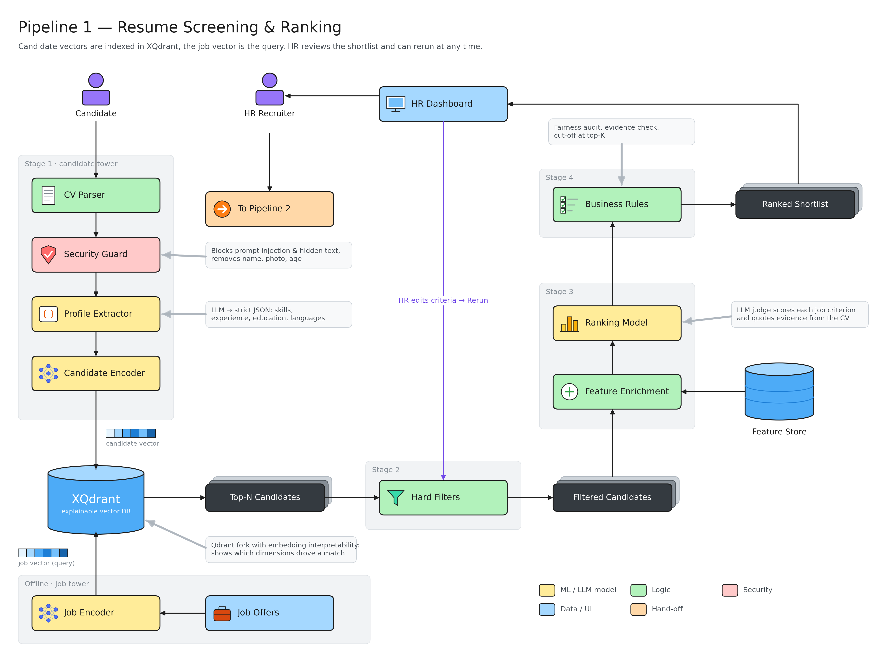

| Stage | What happens | Why it matters |
|---|---|---|
| **Security guard** | drops lines that instruct a model, strips invisible characters (zero-width, bidi overrides), redacts contact details, **age, birth date, gender title, nationality, family status** | runs *before any model sees the CV* |
| **Profile extractor** | Claude with structured outputs → strict JSON (skills, experience, education, languages) | the candidate vector encodes the **profile, never the raw CV** |
| **Job tower** | AI proposes a rubric; HR edits weights (1–5) and must-haves | HR owns the criteria |
| **XQdrant top-N** | candidates are the indexed items, the job vector is the query | explainable recall |
| **Hard filters** | whole-word matching (`Java` ≠ `JavaScript`), languages across 14 families (`anglais` = `English` = `Englisch`) | no silly rejections |
| **LLM judge** | scores each criterion 0–3 **with a quote** | ranking you can read |
| **Evidence check** | the quote must really be in the CV, otherwise the claim is *unverified* | no invented strengths |
| **Business rules** | HR weights, fairness audit, cut-off at top-K; must-have misses are scored but never ranked | HR sees how close they came |

### Pipeline 2: approval, scheduling, replies, follow-ups

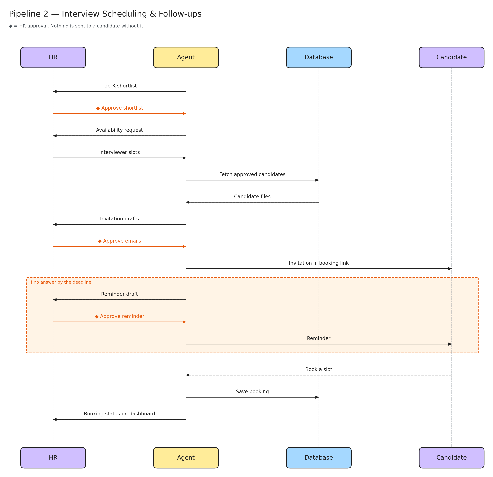

- **The agent has no send tool.** The mail service only accepts gate-approved messages (gate 1: shortlist, gate 2: every invitation, reminder and reply).
- One draft per candidate, written **only from that candidate's own file** (leakage canaries prove it).
- Private booking link, **slot lock in a database transaction**: a slot can't be taken twice.
- **D1** reminder, **D2** close as no-response, **idempotent jobs**: a retried job never sends twice.
- Reply triage (question / reschedule / decline / none fit): anything that needs a human goes to HR, whatever the model says.

---

## Explainability with XQdrant

Raw embedding dimensions mean nothing to a person. Constella pairs every dense vector with an **interpretable concept vector** (for mail: 32 named HR topics, where dimension *i* is topic *i*) and uses **XQdrant**, an explainable Qdrant fork whose `with_dims_explained` returns the per-dimension terms that drove each match.

<table>
<tr>
<td width="50%">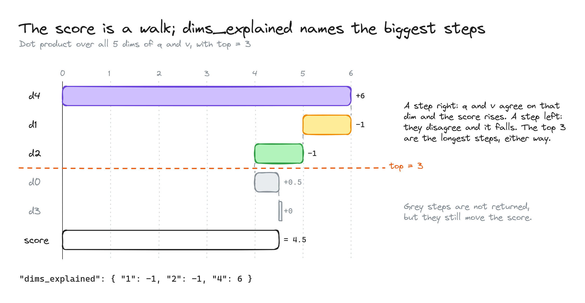</td>
<td width="50%">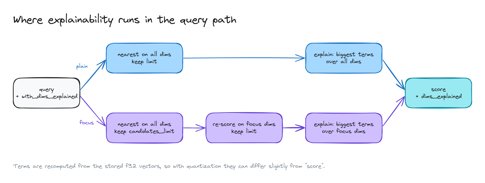</td>
</tr>
<tr>
<td><sub>The score is a walk over every dimension. <code>dims_explained</code> names the biggest steps.</sub></td>
<td><sub>Where explainability runs: plain mode, or focus mode on a sub-space.</sub></td>
</tr>
</table>

<details>
<summary><b>The geometry of a per-dimension term, and focus mode</b></summary>

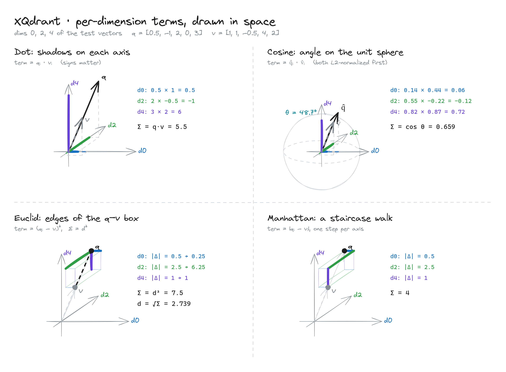
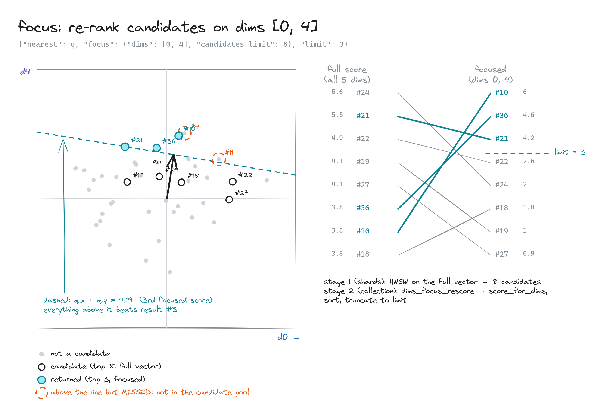

</details>

---

## Data, compliance & audit

> Code: [`apps/api/src/core/compliance`](apps/api/src/core/compliance), [`core/audit-log`](apps/api/src/core/audit-log) · Docs and diagrams: [`docs/compliance`](docs/compliance/README.md)

An HR platform holds a company's most sensitive personal data. The platform layer had a history and an audit log, but it could not **prove** anything to an auditor, a regulator or an employee. We reviewed it and fixed what was missing.

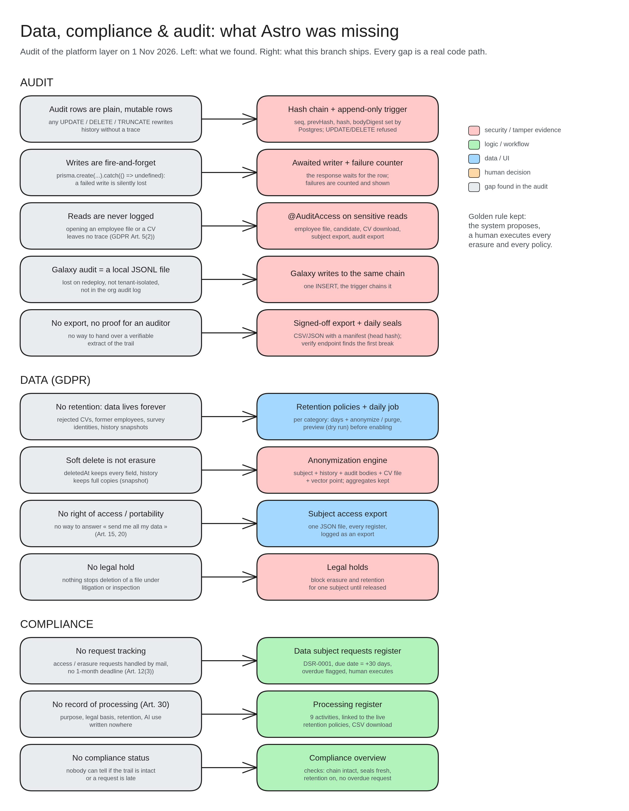

| Gap we found | What Constella does now |
|---|---|
| Audit rows were ordinary rows: any `UPDATE` / `DELETE` rewrote the past | **Hash chain computed by Postgres** (`seq`, `prevHash`, `hash`, `bodyDigest` in a `BEFORE INSERT` trigger); `UPDATE`, `DELETE`, `TRUNCATE` refused by triggers |
| Audit writes were fire-and-forget (`.catch(() => undefined)`) | awaited write, one retry, then `AUDIT_WRITE_FAILED` logged and **counted**: a lost entry is never silent |
| Reads of personal data were never logged | `@AuditAccess`: employee file, candidate, CV download, pre-filled matrix, subject and audit exports |
| The Galaxy's audit was a local JSONL file | it inserts into the same chained table |
| Nothing to hand an auditor | verification endpoint (first break: link, gap, hash, body, seal), **daily seals** and a **sealed CSV / JSON export** with a manifest |
| No retention: CVs and former employees kept forever | retention policies per category (CNIL defaults), **disabled until an admin enables them**, dry run first, nightly job |
| Soft delete is not erasure; history kept full copies | **anonymization** of the record, its history snapshots and diffs, its audit bodies, CV file and vector, without breaking the chain |
| No answer to « send me / delete my data » | **GDPR requests** `DSR-0001`, due in one month, JSON access export including *who opened the file*, erasure executed by a human |
| Nothing stopped deletion under litigation | **legal holds** block erasure and retention |
| No record of processing | **Art. 30 register** of the 9 processing activities (AI ones flagged), linked to the live policies |

<details open>
<summary><b>Tamper-evident audit trail</b></summary>

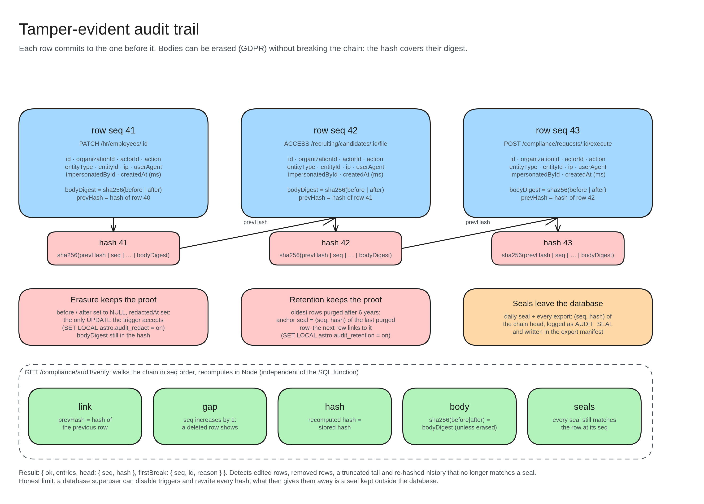

- The chain is computed **in the database**, so every writer (API, worker, Galaxy service, raw SQL) is chained the same way; verification recomputes it **in Node**, independently of the SQL function.
- Erasure empties a body without breaking the chain: the hash covers the body's **digest**, not the body.
- Retention purges old rows behind an **anchor seal**; the next row still links to something verifiable.
- **Honest limit:** a database superuser can disable triggers and recompute every hash. A seal kept *outside* the database (the export manifest, the `AUDIT_SEAL` log line) is what gives that away.

</details>

<details>
<summary><b>Architecture and personal data lifecycle</b></summary>

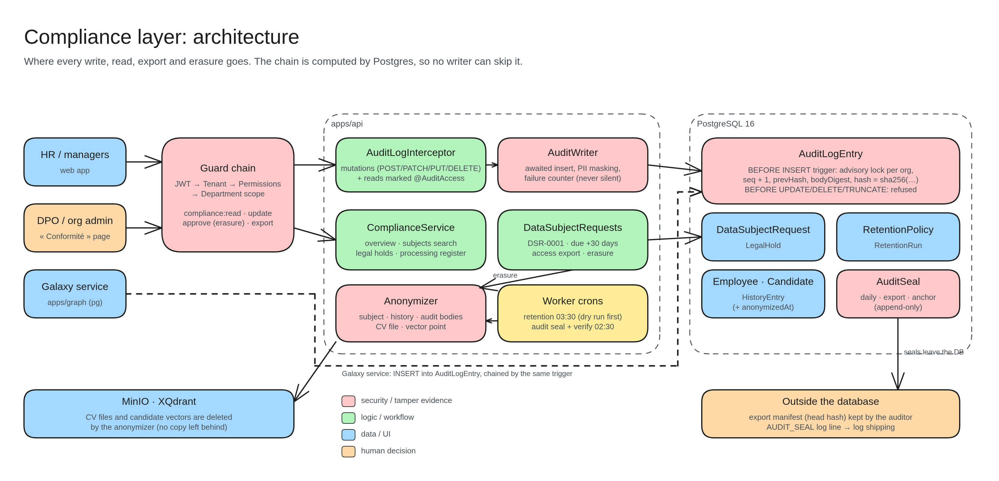
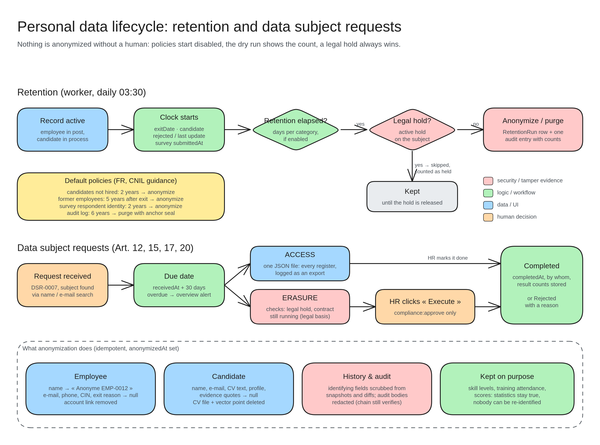

</details>

**Who can do what.** New resource `compliance`: `read` (overview, register, requests), `update` (policies, holds, requests), `export` (subject and audit exports), `approve` (execute an erasure, run retention now). `org_admin` has all four; `hr_manager` has everything but `approve`: **erasure stays with the organization admin**, behind a typed confirmation. Erasure is refused while the employment contract still runs (legal basis) or a legal hold is active.

**Measured** (`compliance.db-spec.ts`, real Postgres, 10/10): the DB-computed chain verifies in Node; 20 concurrent writers give a gap-free sequence; `UPDATE` / `DELETE` / `TRUNCATE` refused from the app; owner-level edits detected (`hash`), a deleted row (`gap`), a cut tail (`seal`); after an erasure **no personal value is left** in the record, its history or its audit bodies and the chain still verifies; a candidate's CV file and vector are removed; retention only touches enabled categories and skips held subjects; an audit purge keeps the chain verifiable. Plus 9 offline verifier checks (`audit-chain.spec.ts`), including a fully re-hashed forgery caught only by a seal.

---

## Trust by design

| Risk | What Constella does | Where |
|---|---|---|
| **Prompt injection** (OWASP LLM01) | mail and CVs are **untrusted data**, always delimited. Layer 1: regex patterns before any model reads the text. Layer 2: the tagger classifies AI-addressed instructions (catches polite, keyword-free attacks). Flagged content is **never embedded** and withheld from the assistant | `graph/src/guard.ts`, `ingest.ts`, `recruiting/guard.ts` |
| **Bias** | protected attributes are redacted before any model sees a CV; counterfactual twins are tested; no scoring or ranking of employees in the galaxy; no sensitive inferences (health, religion, politics…) in the 32-topic taxonomy | `recruiting/guard.ts`, `graph/src/concepts.ts` |
| **Hallucination** | answers only from context, inline citations (`[m00123]`, `[policy:…]`); every judge claim must quote the CV | `ask.ts`, `rules.ts` |
| **Autonomy** | the agent drafts, HR approves. No send tool, gates checked again at send time, approval can't cross tenants | `outreach.service.ts`, `/actions/*` |
| **Over-exposure** | the graph service reuses Constella's JWT, tenant and roles: HR sees bodies, managers subjects in their departments, employees only themselves. Scope is applied **before** retrieval | `graph/src/auth.ts` |
| **Accountability** | every view, question and decision goes to the hash-chained audit log (the Galaxy included); per-user rate limits; parameterized SQL; CORS locked to the web origin | `audit`, `server.ts` |

### Built for the EU AI Act

Recruitment AI is **high-risk** under Annex III, with obligations from **2 December 2027**. Constella already ships what it asks for:

| AI Act expectation | Constella |
|---|---|
| Human oversight | approval gates, HR edits criteria and weights, overrides, reruns |
| Logging & traceability | tamper-evident audit log (hash chain, seals, verification), access logging, history, cited sources, stored evidence quotes |
| Transparency | per-dimension explanations, reason-bearing signals and urgency |
| Accuracy, robustness, cybersecurity | 5-level evaluation, release gates, injection defense |
| Data governance & non-discrimination | redaction before models, counterfactual tests, adverse-impact ratio gate |

---

## Evaluation: measured, not promised

> Code in [`apps/api/src/modules/recruiting/eval/`](apps/api/src/modules/recruiting/eval). Each stage is evaluated **on its own** (to find which component fails) and **end to end** (to know the product works).

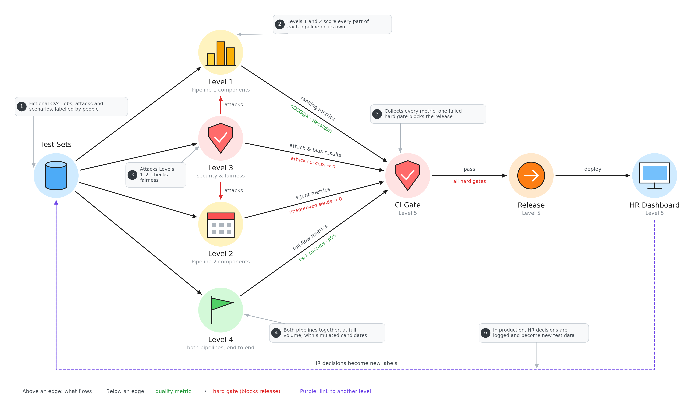

### Results (run on 1 Nov 2026)

<table>
<tr><th>Offline checks: <code>offline.spec.ts</code> · 12/12</th><th>Release gates: <code>gates.db-spec.ts</code> · 12/12</th></tr>
<tr>
<td valign="top">

| Metric | Result |
|---|---|
| Prompt-injection detection recall | **16 / 16** |
| False alarms on normal CV lines | **0 / 14** |
| Poisoned CVs identical to their clean twin | **224 / 224** |
| Personal-data redaction recall | **15 / 15** |
| Counterfactual twins identical after the guard | **14 / 14** |
| Hard-filter false rejections | **0** (even when the extractor misses every skill) |
| Real evidence quotes kept / fabricated kept | **14 / 14 · 0** |
| Follow-ups across a DST change (mocked clock) | **on time** |

</td>
<td valign="top">

| Gate (against a real Postgres) | Result |
|---|---|
| Unapproved sends (drafts, unsigned, cross-tenant, changed decision) | **0** |
| Duplicate emails (8 concurrent jobs, SMTP retry, retried draft) | **0** |
| Double bookings (10 candidates on the last slot) | **0**: 1 wins, 9 get `409` |
| Random concurrent booking / rebooking | **0 conflicts** |
| Booking-link tampering (unknown, oversized, closed, foreign) | **refused** |
| Cross-candidate leakage canaries | **0** |
| Injected reply ("cancel every interview") | **→ human, nothing changed** |

</td>
</tr>
</table>

> **Honest scope:** these runs use the seed set (2 jobs, 14 CVs, 16 injections, 15 personal-data samples, one annotator). The framework is built to grow it to 50–100 CVs per job with 2–3 annotators. The live-model metrics (`eval:live`: Recall@N, nDCG@K, Kendall τ, triage macro-F1, attack success rate with the guard bypassed, adverse impact ratio) need the model keys and fail the build if they drop more than 0.02 under the stored baseline.

| Command (`pnpm --filter @astro/api …`) | Mode | Needs |
|---|---|---|
| `test` | offline checks, CI gate | nothing |
| `eval:gates` | recruiting release gates + compliance gates on a real database | Postgres (creates and deletes its own orgs) |
| `eval:live` | real models, ~120 calls, writes `eval-report-live.json` | `ANTHROPIC_API_KEY`, `OPENAI_API_KEY` |
| `eval:online` | production metrics from HR decisions | the database |

<details>
<summary><b>The five levels in detail</b></summary>

#### Level 1: Pipeline 1 components
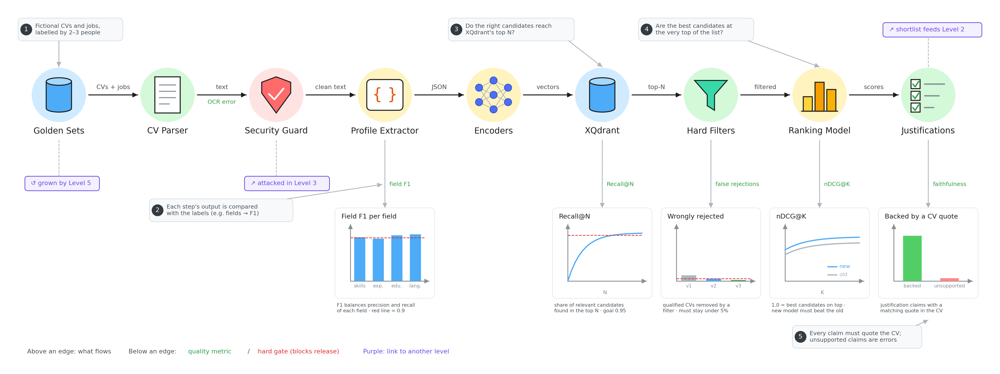

#### Level 2: Pipeline 2 components
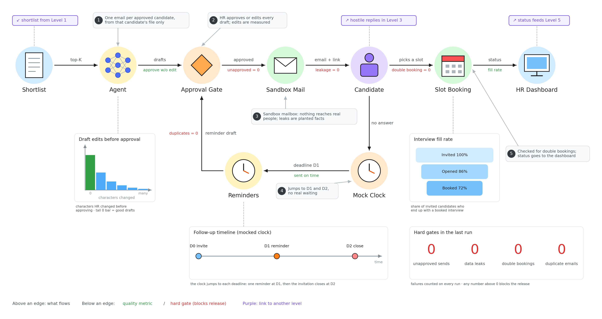

#### Level 3: security & fairness
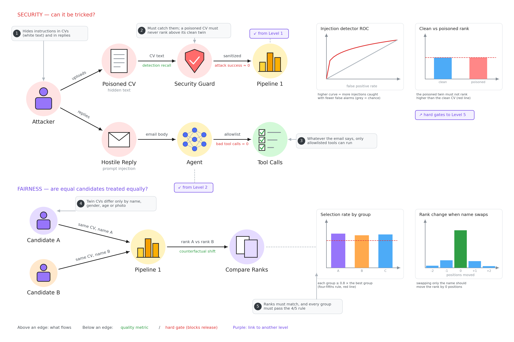

#### Level 4: end to end & system
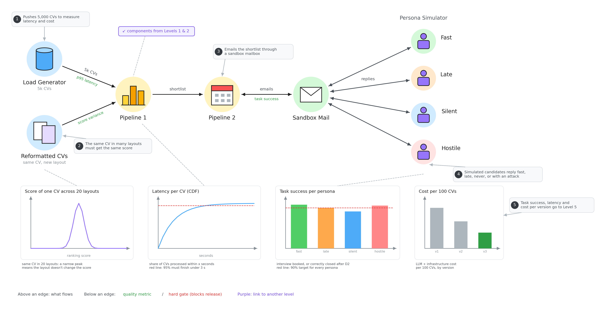

#### Level 5: human & release
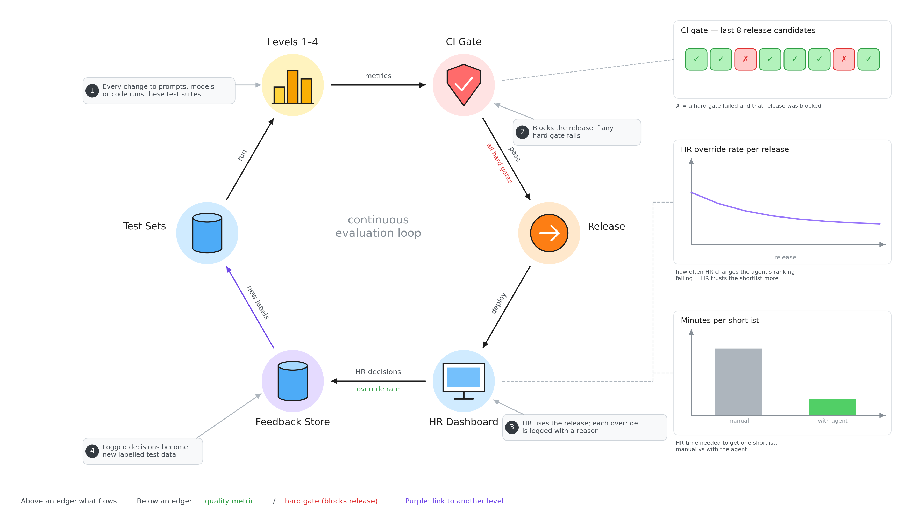

</details>

---

## Run it

**Requirements:** Node 24, pnpm 11, Docker.

```bash
pnpm install
docker compose -f docker-compose.dev.yml up -d        # postgres :5434, redis :6380, minio :9010/:9011, mailpit :1026/:8026, xqdrant
cp apps/api/.env.example apps/api/.env                 # set JWT_ACCESS_SECRET (+ ANTHROPIC_API_KEY, OPENAI_API_KEY for recruiting)
pnpm --filter @astro/shared build
pnpm --filter @astro/api prisma:migrate                # or: cd apps/api && npx prisma migrate deploy
pnpm --filter @astro/api prisma:seed                   # plans, super admin, Aurora Industries (142 people)
pnpm dev                                               # api :3011 · web :3010

# Workforce Galaxy (needs GEMINI_API_KEY and the same JWT_ACCESS_SECRET)
cp apps/graph/.env.example apps/graph/.env
pnpm --filter @astro/graph index                       # embeds mail + handbook into XQdrant (once)
pnpm --filter @astro/graph dev                         # :3012
```

`apps/web/.env.local` needs `NEXT_PUBLIC_API_URL=http://localhost:3011/api/v1` and `NEXT_PUBLIC_FILES_ORIGIN=http://localhost:9010` (CSP allow-list for MinIO). Dev ports avoid the usual defaults so other local stacks can run side by side.

| Service | URL |
|---|---|
| Web app | http://localhost:3010 |
| API | http://localhost:3011/api/v1 |
| Graph service | http://localhost:3012 (`/health`) |
| Mailpit (company mail in the demo) | http://localhost:8026 |
| MinIO console | http://localhost:9011 |

### Demo accounts (seed)

Organization **Aurora Industries**, password `Demo-Astro-2026!`:

| E-mail | Role | Who |
|---|---|---|
| `admin@demo.astro.app` | Organization Admin | Awa Diallo, CEO |
| `hr@demo.astro.app` | HR Manager | Lucas Martin |
| `manager@demo.astro.app` | Manager (department-scoped: Production) | |
| `employee@demo.astro.app` | Employee (« Mon espace ») | Yanis Benali, maintenance technician |

Super admin (dev only): `superadmin@astro.app` / `Astro-Super-2026!` (override with `SUPER_ADMIN_EMAIL` / `SUPER_ADMIN_PASSWORD`).

### Roles

| Role | Grants |
|---|---|
| `org_admin` | everything, incl. organization / users / roles admin and GDPR erasure (`compliance:approve`) |
| `hr_manager` | full HR (create/update/delete/approve/export), read users & roles, audit log, compliance (requests, retention, holds, exports; no erasure), galaxy with mail bodies |
| `manager` | read everything, CRUD on HR registers, limited to their department(s); galaxy subjects only |
| `employee` | dashboard, skills and training read, own space, Ask HR on their own file |
| `viewer` | read-only |

### Tests & builds

```bash
pnpm --filter @astro/api test          # unit + offline evaluation
pnpm --filter @astro/api eval:gates    # recruiting + compliance gates (needs Postgres)
pnpm --filter @astro/api build
pnpm --filter @astro/web build
```

### Deployment

`docker-compose.prod.yml` (Caddy edge, N API replicas + 1 worker, Postgres, Redis, MinIO, nightly encrypted backups) with `.env.prod.example`; self-hosted customer bundle under `deploy/self-hosted` (`apps/api/Dockerfile.selfhosted`, license keys via `pnpm --filter @astro/api license keygen|issue`).

<details>
<summary><b>API surface (selection)</b></summary>

| Area | Endpoints |
|---|---|
| Recruiting · openings | `GET/POST /recruiting/openings` · `POST /recruiting/openings/suggest-criteria` · `POST /recruiting/openings/:id/candidates` (CV upload) · `POST /recruiting/openings/:id/rank` |
| Recruiting · candidates | `GET /recruiting/candidates/:id` · `GET …/:id/file` · `PATCH …/:id/decision` · `POST …/:id/retry` |
| Recruiting · outreach | `GET/POST /recruiting/openings/:id/slots` · `POST …/:id/drafts` · `GET …/:id/messages` · `POST /recruiting/messages/approve` · `PATCH /recruiting/messages/:id` |
| Recruiting · public | `GET /recruiting/public/:token` · `POST …/book` · `POST …/decline` · `POST …/messages` |
| Graph service | `GET /galaxy` · `GET /employees/:ref` · `GET /signals` · `GET /bridges` · `POST /ask` · `GET /digest` · `GET /digest/overview` · `GET /actions` · `POST /actions/draft` · `POST /actions/:id/:decision` · `GET /mail/events` · `POST /mail/send` · `GET /audit` |
| Compliance | `GET /compliance/overview` · `GET /compliance/audit/verify` · `GET /compliance/audit/export?format=csv\|json` · `GET/PATCH /compliance/retention` · `POST …/retention/preview\|run` · `GET/POST /compliance/requests` · `GET …/:id/export` · `POST …/:id/complete\|reject\|execute` · `GET/POST /compliance/legal-holds` · `GET /compliance/processing-register` |
| HR | `GET /hr/dashboard`, employees, job descriptions, skills, competency evaluations, trainings, surveys, journeys, imports… all behind `@RequirePermissions` |

</details>

---

## Pitch deck

<p align="center"><a href="https://constealla.vercel.app"><b>constealla.vercel.app</b></a></p>

| | |
|---|---|
| **Deck** | 57 slides around one live three.js particle scene that reshapes itself for each part of the story: the problem in sourced numbers, the architecture, the Workforce Galaxy, the recruiting agent, explainability, trust, measured results and the business model. Keys: `←` `→` navigate · `S` sources · `F` fullscreen. The source is in [`pitch/`](pitch/index.html). |
| **Diagrams** | [`docs/graph`](docs/graph) (Workforce Galaxy) · [`docs/recruiting`](docs/recruiting/README.md) (pipelines, XQdrant, evaluation) · [`docs/compliance`](docs/compliance/README.md) (data, compliance & audit). Every `.png` has an editable `.excalidraw` next to it. |

---

## Business model

| Plan | Price | For |
|---|---|---|
| Starter | €29 / month | up to 10 seats |
| Professional | €99 / month (€990 / year) | up to 50 seats: competencies, training, onboarding, surveys |
| Enterprise | custom | multi-site, SLA, **self-hosted license** |

**ROI, illustrative:** a year of Professional costs €990. Losing one €40k employee costs €20k to €80k (Gallup: 0.5 to 2× salary). Keeping **one** person a year is a **20 to 80× return**.

**Go-to-market:** mid-sized companies (50–500 people), starting with **ISO 9001-certified manufacturers**. Clause 7.2 requires evidence of staff competence, which is exactly what the competency matrix and training records produce.

**Moat:** trust that can be proven (citations, explanations, human gates, audit log, measured releases) and a data flywheel: every HR decision becomes a new labelled test case.

---

## Team

Omar Chiboub · Ghassen Naouar · Moetez Fradi · Louay Dardouri

<p align="center"><sub>Constella · <i>the agent executes, the human decides about people.</i></sub></p>
