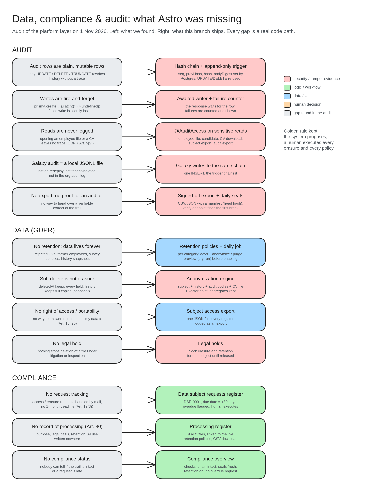
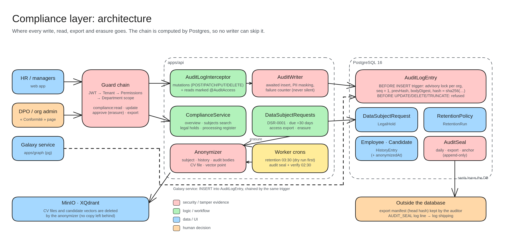
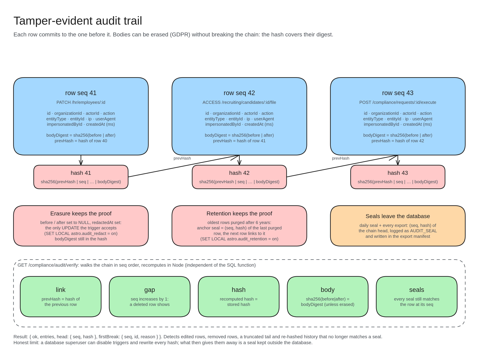
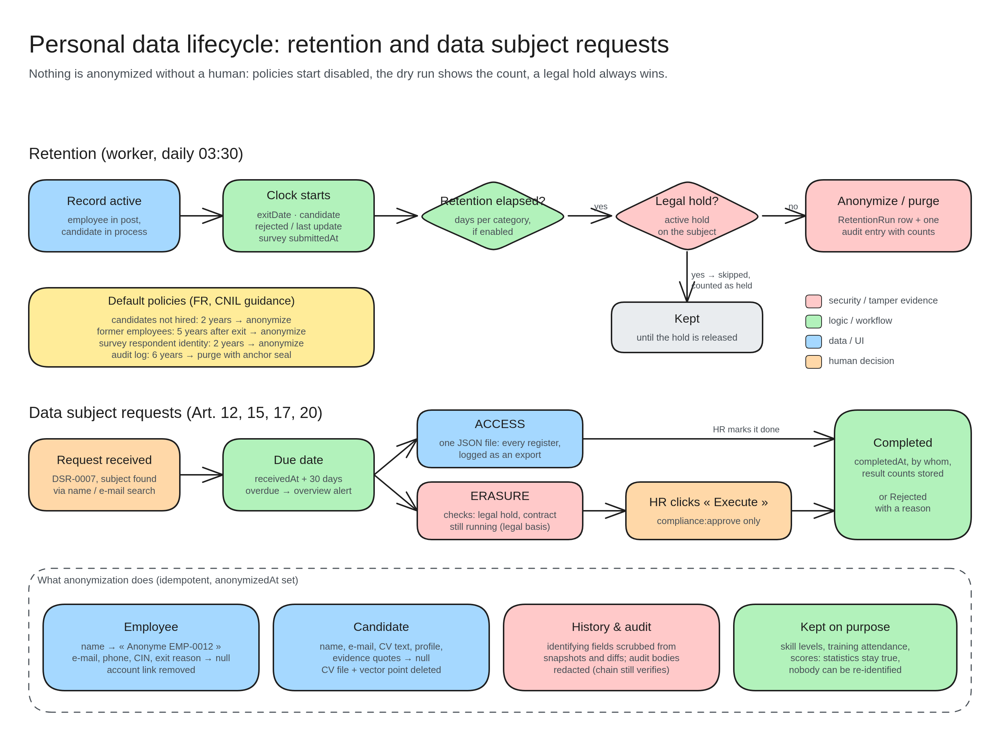

# Data, compliance & audit

An HR platform holds the most sensitive personal data a company has: identity numbers, contracts, exit reasons, competency gaps, CVs. Astro inherited a solid platform layer (tenancy, RBAC, department scope, field-level history, an audit log), but a review on 1 Nov 2026 showed it could not *prove* anything to an auditor, a regulator or an employee. This folder records what was missing and how the compliance layer fixes it.

| Diagram | File |
|---|---|
| Gap analysis: what we found → what ships | `compliance-0-gaps.excalidraw` |
| Architecture of the compliance layer | `compliance-1-architecture.excalidraw` |
| Tamper-evident audit trail (hash chain, seals, verification) | `compliance-2-audit-chain.excalidraw` |
| Personal data lifecycle: retention and data subject requests | `compliance-3-data-lifecycle.excalidraw` |

Open them at <https://excalidraw.com> (Menu → Open) or with the VS Code Excalidraw extension. Legend: red = security / tamper evidence, green = logic, blue = data / UI, orange = human decision, grey = gap.

## Critique: what was missing

### Audit

| # | Gap | Evidence in the code (before this branch) | Why it matters |
|---|---|---|---|
| A1 | **The audit log was an ordinary table.** | `AuditLogEntry` had no integrity field; any `UPDATE`, `DELETE` or `TRUNCATE` rewrote the past without a trace. | An audit trail you can edit is not evidence (ISO 27001 A.8.15, SOC 2 CC7.2, GDPR Art. 5(2) accountability). |
| A2 | **Writes were fire-and-forget.** | `AuditLogInterceptor`: `void prisma.auditLogEntry.create(...).catch(() => undefined)`. | A database blip silently dropped the entry while the change itself was committed. Nobody would ever know. |
| A3 | **Reads were never logged.** | Only `POST/PATCH/PUT/DELETE` were captured. Opening an employee file, a candidate, or downloading a CV left nothing. | « Who looked at my file? » is the first question in any HR privacy complaint; the EU AI Act also expects traceability of who used the recruiting output. |
| A4 | **The Galaxy audit lived in a local file.** | `apps/graph/src/server.ts` appended to `data/audit.jsonl`. | Lost on every redeploy, outside the org's audit log, no tenant isolation in storage. |
| A5 | **No export, no verification.** | The only reader was the paginated admin tab. | An auditor needs an extract they can check offline. |
| A6 | **The humanizer described an export that no longer exists.** | `EXPORT` rows were summarised as « full company ZIP » (a leftover of the QMS platform). | Misleading wording in a legal record. |

### Data (GDPR)

| # | Gap | Evidence | Why it matters |
|---|---|---|---|
| D1 | **No retention.** | Rejected candidates, CV files, CV vectors, former employees and survey identities were kept forever. | Art. 5(1)(e) storage limitation. CNIL guidance: 2 years for unsuccessful candidates, about 5 years after departure for most staff records. |
| D2 | **Soft delete is not erasure.** | `deletedAt` keeps every column; `HistoryEntry.snapshot` keeps a full copy of the record at creation and deletion. | Art. 17: « deleted » records were fully recoverable, including the national ID number (`cin`). |
| D3 | **No right of access / portability.** | No way to export everything about one person. | Art. 15 and 20: one month to answer. |
| D4 | **No legal hold.** | Nothing prevented deleting a file under litigation or a labour inspection. | Erasure and retention must yield to legal claims (Art. 17(3)(e)). |

### Compliance

| # | Gap | Evidence | Why it matters |
|---|---|---|---|
| C1 | **No request tracking.** | Requests were handled by mail. | Art. 12(3): one month, provable. |
| C2 | **No record of processing.** | Purposes, legal bases, retention and AI use were written nowhere. | Art. 30 record of processing activities; AI Act transparency for recruitment (Annex III). |
| C3 | **No compliance status.** | Nobody could tell if the trail was intact, a request was late, or retention was on. | Compliance that is not monitored decays. |

## The solution

### 1. Tamper-evident, append-only audit trail (A1, A2, A4, A5)

- **The chain is computed by Postgres**, in a `BEFORE INSERT` trigger, so every writer (API, worker, Galaxy service, a raw `INSERT`) is chained without trusting application code. Per organization: an advisory lock, `seq = last + 1`, `prevHash = last hash`, `bodyDigest = sha256(before | after)`, `hash = sha256(prevHash | seq | id | org | actor | action | entity | ip | user agent | impersonator | createdAt | bodyDigest)`.
- **Append-only**: `UPDATE`, `DELETE` and `TRUNCATE` are refused by triggers. Two narrow, transaction-local exceptions exist: *redaction* (`SET LOCAL astro.audit_redact = 'on'`: only `before`/`after` → `NULL` + `redactedAt`, every hashed column unchanged) and *retention* (`SET LOCAL astro.audit_retention = 'on'`: delete the oldest rows, after writing an *anchor* seal).
- **Erasure without breaking the proof**: the hash covers the body's digest, not the body, so personal data in a request body can be erased (GDPR) and the chain still verifies.
- **Seals**: a daily job and every export record the chain head `(seq, hash)` in `AuditSeal` (append-only) and print an `AUDIT_SEAL` log line for log shipping. The export manifest carries the head too.
- **Verification** (`GET /compliance/audit/verify`) walks the chain in Node, independently of the SQL function, and reports the first break: `link`, `gap`, `hash`, `body` or `seal`.
- **No silent loss**: the interceptor now awaits the write (one insert, a few ms). A failure is logged at error level and counted in Redis; the overview shows the count.
- **Galaxy service**: writes `ACCESS galaxy/…` rows into the same table; the file is gone.

**Honest limit.** A database superuser can disable triggers and recompute every hash. That is detected only by a seal kept *outside* the database (export manifest, shipped logs). Revoking `UPDATE`/`DELETE` from the application role is the next hardening step for deployments with separate DB roles.

### 2. Access logging (A3)

`@AuditAccess('Employee')` marks a sensitive `GET`; the interceptor then writes `ACCESS /hr/employees/:id` with the record id. Marked today: employee file, candidate file, CV download, the Galaxy employee view and asks, the subject access export and the audit export. The admin audit tab gains an « Accès » filter.

### 3. Personal data lifecycle (D1–D4, C1)

- **Retention policies** per organization and category, with defaults from CNIL guidance. They **start disabled**: an admin sees the dry-run count first, then enables. A daily worker job (03:30) applies enabled policies, skips subjects under legal hold, writes a `RetentionRun` and one audit entry.

  | Category | Clock starts | Default | Action |
  |---|---|---|---|
  | Candidates not hired | last update of a rejected / closed candidate | 730 days | anonymize |
  | Former employees | `exitDate` | 1825 days | anonymize |
  | Survey respondent identity | `submittedAt` | 730 days | anonymize identity, keep answers |
  | Audit log | `createdAt` | 2190 days | purge with an anchor seal |

- **Anonymization** (shared by retention and erasure, idempotent, `anonymizedAt`): identifying fields of the subject, the identifying fields in its history snapshots and diffs, the bodies of its audit entries (redaction, chain intact), the CV file in MinIO and the vector point in XQdrant. Skill levels, attendance and scores are kept: statistics stay true, nobody can be re-identified.
- **Data subject requests**: `DSR-0001`, type `ACCESS` or `ERASURE`, due date = received + 30 days, overdue flagged. Access = one JSON export of every register about the person. Erasure is executed by a human with `compliance:approve`, refused while a legal hold is active or while the employment contract still runs (legal basis), and records what was changed.
- **Legal holds** block retention and erasure for one subject until released.

### 4. Record of processing and overview (C2, C3)

- **Processing register** (Art. 30): every processing activity of Astro, including the two AI systems, with purpose, legal basis, data categories, subjects, recipients, retention (linked to the live policy) and AI involvement. Downloadable as CSV.
- **Compliance overview**: chain intact, seals fresh, no lost audit write, retention enabled, no overdue request, legal holds count.

### Permissions

New resource `compliance`: `read` (overview, register, requests), `update` (policies, holds, requests), `approve` (execute an erasure, run retention), `export` (subject export, audit export). `org_admin` gets all four, `hr_manager` gets `read`, `update`, `export`: erasure stays with the organization admin.

## Not in scope (next steps)

- Field-level encryption of `Employee.cin` (the secret cipher exists in `core/auth/secret-cipher.ts`).
- Separate database roles so the API user cannot `ALTER TABLE … DISABLE TRIGGER`.
- Logging denied attempts (403) and sign-in events in the organization log (they are guarded, not yet traced).
- Rectification (Art. 16) is handled by the normal edit screens and their history; it has no request type of its own.
