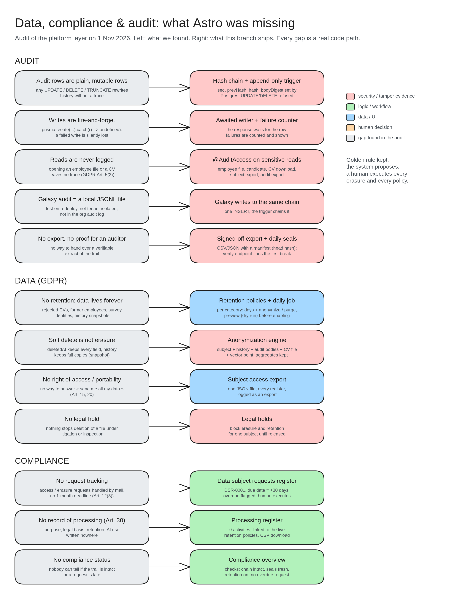

# Data, compliance & audit: what was missing

A review on 1 Nov 2026: on the left is what we found (grey), on the right is what we built.

**Audit**
- Audit rows could be edited or deleted → now a **hash chain** where each row locks the one before it, and changes are refused.
- Writes could fail silently → now we **wait for the write** and count failures.
- Reads were never logged → sensitive pages (employee file, CV download…) are **logged when opened**.
- The Galaxy kept its log in a local file → it now writes into the **same chain**.
- No export for auditors → a **verifiable export** plus daily **seals**.

**Data (GDPR)**
- Data was kept forever → **retention policies** with a daily job and a preview first.
- Soft delete is not real deletion → an **anonymization engine** scrubs the person everywhere.
- No "send me all my data" → a one-file **subject access export**.
- No way to freeze a file → **legal holds** block deletion.

**Compliance**
- Requests handled by email → a **request register** with a 30-day due date.
- No record of processing → a **processing register** (purpose, legal basis, retention, AI use).
- No status → a **compliance overview** page.
