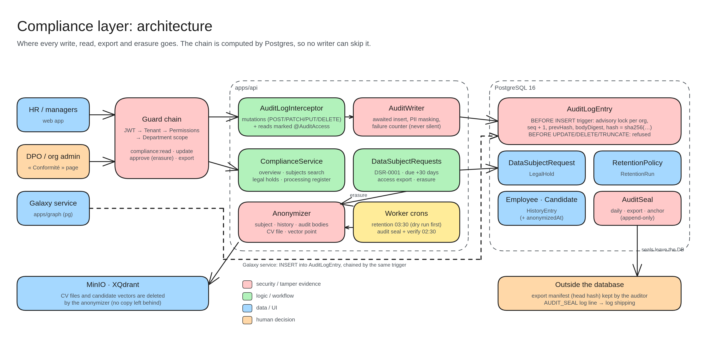

# Compliance layer: architecture

Where every write, read, export and erasure goes.

- **Who comes in:** HR and managers (web app), the DPO or org admin (« Conformité » page) and the Galaxy service.
- **Guard chain:** login → organization → permissions → department. New permissions cover compliance read, update, approve (erasure) and export.
- **AuditLogInterceptor + AuditWriter:** log every change and every sensitive read, hide personal details, and wait for the write so nothing is lost.
- **ComplianceService / DataSubjectRequests:** the overview, legal holds, the processing register, and access or erasure requests (due in 30 days).
- **Anonymizer:** scrubs a person from records, history and audit bodies, and deletes their CV file (MinIO) and search vector (XQdrant).
- **Worker crons:** retention at 03:30 (preview first), and seal + check of the audit chain at 02:30.
- **PostgreSQL:** the database itself builds the audit chain, so no writer can skip it. Edits and deletes of audit rows are refused.
- **Outside the database:** seals are copied out (export file, log lines), so even a database admin can't quietly rewrite history.
