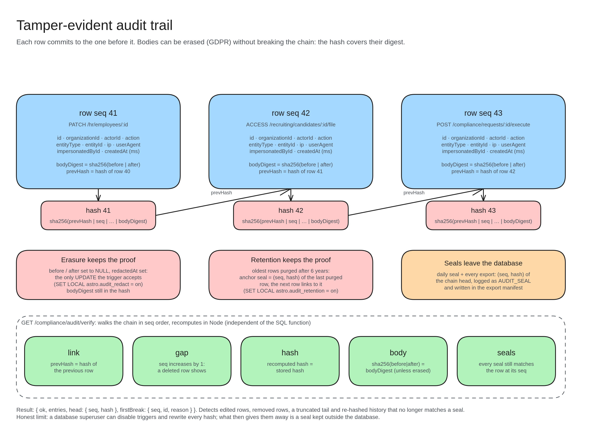

# Tamper-evident audit trail

Why nobody can quietly change the audit log.

- **Each row has a fingerprint (hash)** built from its own data *and* the previous row's fingerprint. Change one row and every fingerprint after it stops matching, like a chain of seals.
- **The body is fingerprinted separately (bodyDigest):** personal data can be erased for GDPR and the chain still checks out.
- **Erasure keeps the proof:** the only allowed edit sets the before/after data to empty, and the fingerprint stays.
- **Retention keeps the proof:** after 6 years the oldest rows are deleted, but an "anchor" seal remembers where the chain continues.
- **Seals leave the database:** every day and every export records the latest fingerprint outside the database.
- **Verify endpoint** checks five things: links match, no missing numbers, fingerprints match, bodies match, and seals still match.
- **Honest limit:** a database superuser could rewrite everything, but a seal kept outside the database would give it away.
