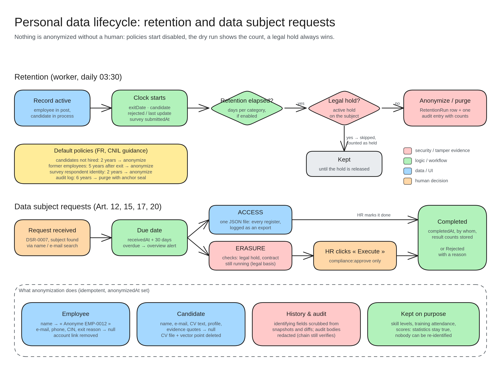

# Personal data lifecycle: retention & data subject requests

Nothing is anonymized without a human: policies start switched off, a preview shows the count first, and a legal hold always wins.

**Retention (daily at 03:30)**
- The clock starts when a person leaves, a candidate is rejected, or a survey is submitted.
- When the time is up (and the policy is on), the job checks for a **legal hold**. If there is one, the record is kept. If not, it is anonymized or purged and the run is logged.
- **Defaults (French CNIL guidance):** rejected candidates 2 years, former employees 5 years after exit, survey identity 2 years, audit log 6 years.

**Data subject requests (GDPR)**
- A request gets a number (DSR-0007) and a due date 30 days later. Late requests raise an alert.
- **Access:** one JSON file with everything about the person.
- **Erasure:** checks for a legal hold and whether the contract is still running, then waits for someone with approve rights to click « Execute ».

**What anonymization does**
- **Employee / candidate:** name replaced, contact details and CV text emptied, CV file and search vector deleted.
- **History & audit:** identifying data scrubbed, and the audit chain still verifies.
- **Kept on purpose:** skills, training attendance and scores, so statistics stay true but nobody can be identified.
