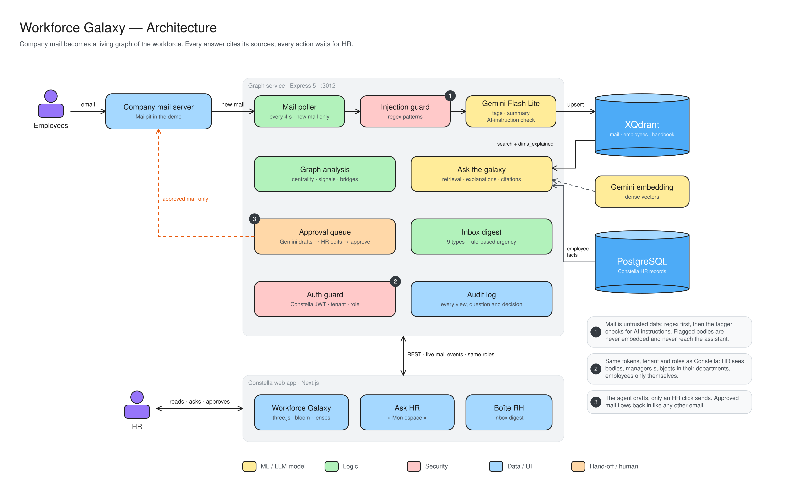
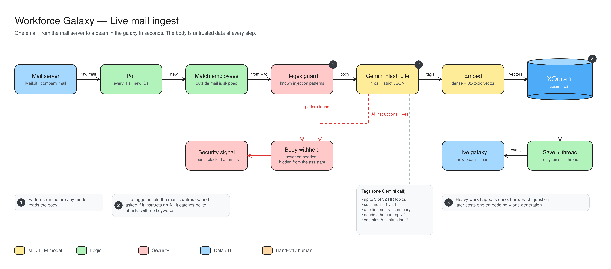
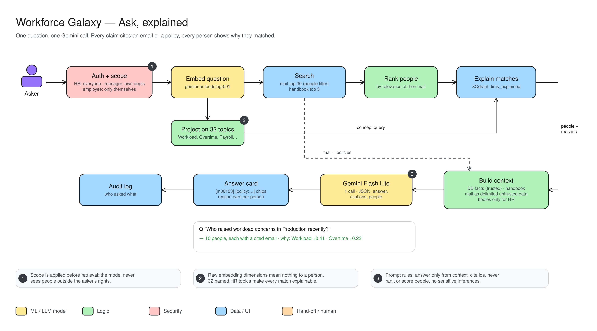
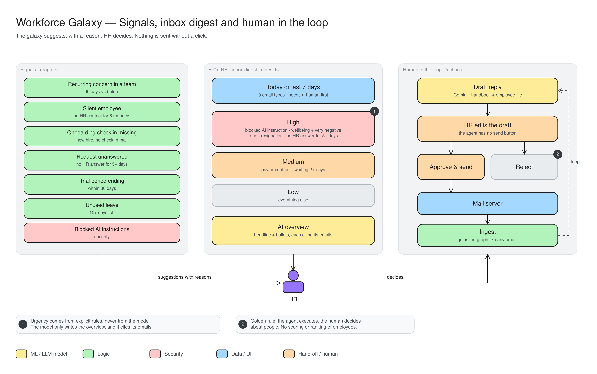

# Workforce Galaxy: architecture

The graph service (`apps/graph`) and its web views (Galaxie RH, Ask HR, Boîte RH).
Golden rule: *the agent executes, the human decides about people.*

| Diagram | Explained |
|---|---|
| Architecture: mail → graph service → stores → web app | [`galaxy-1-architecture.md`](galaxy-1-architecture.md) |
| Live mail ingest, with the two-layer injection defense | [`galaxy-2-live-ingest.md`](galaxy-2-live-ingest.md) |
| Ask, explained: scope, retrieval, concept axes, one Gemini call | [`galaxy-3-ask.md`](galaxy-3-ask.md) |
| Signals, inbox digest and human in the loop | [`galaxy-4-signals-digest.md`](galaxy-4-signals-digest.md) |

Same legend as `docs/recruiting`: yellow = ML / LLM, green = logic, red = security, blue = data / UI, orange = hand-off.

