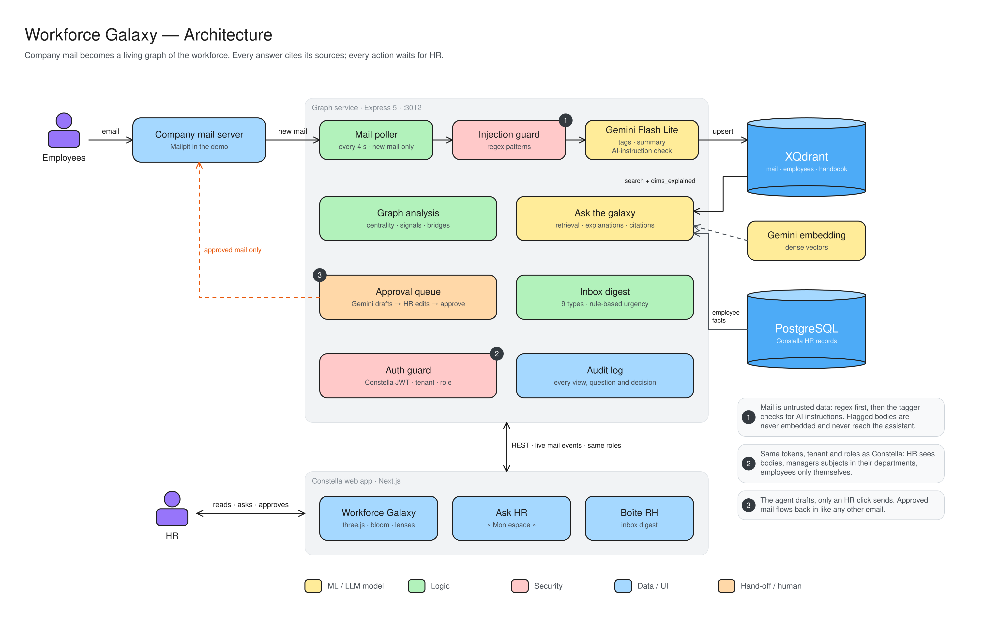

# Workforce Galaxy: architecture

Company email becomes a living map of the workforce. Every answer cites its sources, and every action waits for HR.

- **Mail in:** employees send email, and the mail poller picks up new mail every 4 seconds.
- **Injection guard (1):** email is untrusted. Known attack patterns are checked first, then the AI tagger checks whether the mail is trying to instruct an AI. Flagged mail is never stored as searchable data and never reaches the assistant.
- **Gemini Flash Lite:** tags each mail with topics and a summary, then saves it in XQdrant.
- **Stores:** XQdrant holds mail, employee and handbook vectors. PostgreSQL holds the HR records.
- **Features:** graph analysis (who connects to whom), Ask the galaxy (search with explanations and citations) and the inbox digest (sorted by urgency rules).
- **Approval queue (3):** the AI drafts replies, HR edits and approves. Only approved mail goes back to the mail server.
- **Auth guard (2):** same logins and roles as the main app. HR sees everything, managers see their departments, employees see only themselves.
- **Audit log:** records every view, question and decision.
- **Web app:** HR uses three screens: Workforce Galaxy (3D view), Ask HR and Boîte RH (inbox).
