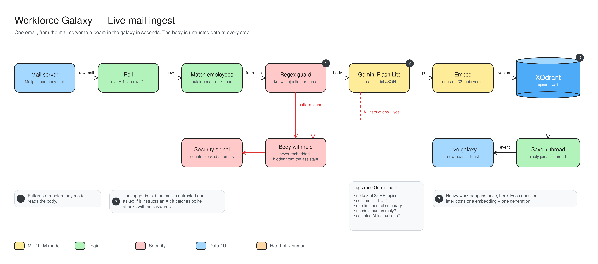

# Workforce Galaxy: live mail ingest

One email's path from the mail server to a new beam in the galaxy, in seconds.

- **Poll:** checks for new mail every 4 seconds.
- **Match employees:** mail from outside the company is skipped.
- **Regex guard (1):** looks for known attack patterns before any AI reads the mail.
- **Gemini Flash Lite (2):** one AI call returns up to 3 of 32 HR topics, a mood score, a one-line summary, "needs a human reply?" and "contains AI instructions?". It catches polite attacks that use no keywords.
- **Blocked path (red):** if either check fires, the body is withheld: it is never stored as searchable data, is hidden from the assistant, and is counted as a security signal.
- **Embed → XQdrant (3):** the mail becomes vectors and is saved. The heavy work happens once here, so each later question is cheap.
- **Save + thread → live galaxy:** replies join their thread, and a new beam and notification appear on screen.
