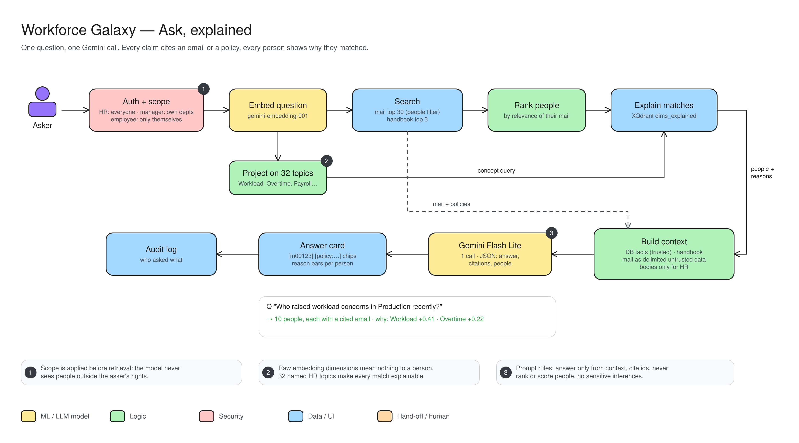

# Workforce Galaxy: Ask, explained

One question, one AI call. Every claim cites an email or a policy, and every person shows why they matched.

- **Auth + scope (1):** limits who can be found *before* searching. HR sees everyone, managers their own departments, employees only themselves.
- **Embed question:** the question becomes a vector.
- **Project on 32 topics (2):** raw vector numbers mean nothing to a person, so the question is also mapped onto 32 named HR topics (Workload, Overtime, Payroll…).
- **Search:** the top 30 matching emails and the top 3 handbook policies.
- **Rank people → explain matches:** people are ranked by how relevant their mail is, and XQdrant says which topics drove each match.
- **Build context:** trusted HR facts plus the handbook, with mail clearly marked as untrusted. Email bodies are included only for HR.
- **Gemini Flash Lite (3):** answers only from this context, cites IDs, never scores people and makes no sensitive guesses.
- **Answer card + audit log:** the answer shows citation chips and reason bars, and the question is logged.
