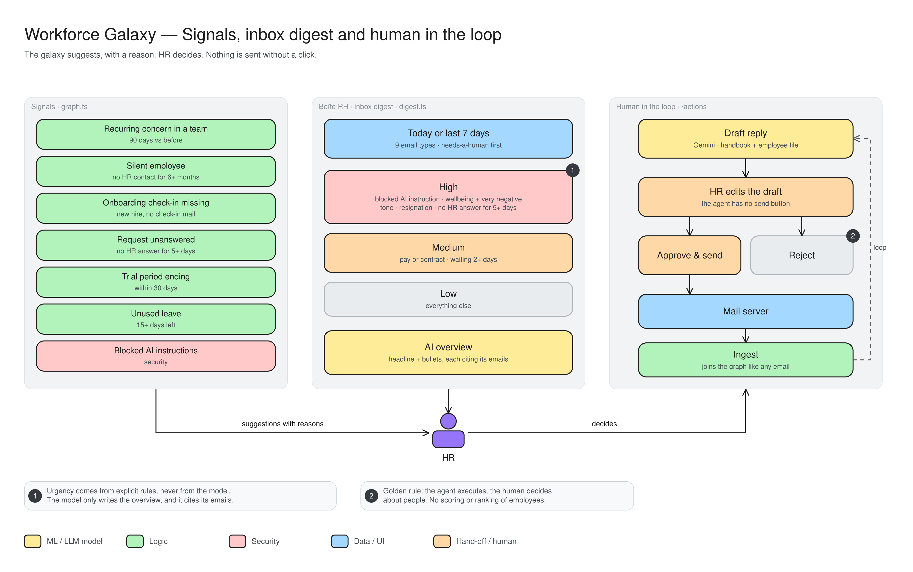

# Workforce Galaxy: signals, inbox digest & human in the loop

The galaxy suggests, with a reason. HR decides. Nothing is sent without a click.

- **Signals:** automatic hints such as a recurring concern in a team, an employee with no HR contact for 6+ months, a missing onboarding check-in, a request unanswered for 5+ days, a trial period ending, unused leave, or blocked AI instructions.
- **Inbox digest (Boîte RH):** today's or the last 7 days' mail, sorted into High, Medium and Low by fixed rules (1). The AI only writes the overview, and it cites its emails.
- **Human in the loop:** the AI drafts a reply from the handbook and the employee's file. HR edits it, because the agent has no send button.
- **Approve & send or Reject (2):** approved mail goes out and comes back into the galaxy like any other email.
- **Golden rule:** the agent does the work, the human decides about people. No scoring or ranking of employees.
