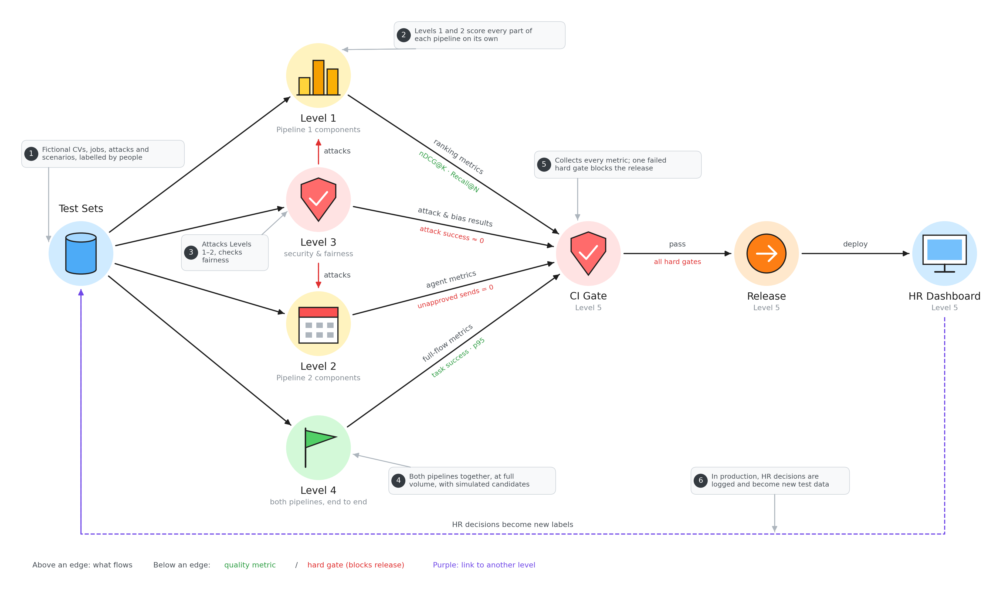

# Evaluation: the big picture

How we check that the recruiting agent works before every release.

- **Test sets:** fake CVs, jobs, attacks and scenarios, labelled by people so we know the right answers.
- **Level 1:** tests each part of Pipeline 1 (screening and ranking) on its own.
- **Level 2:** tests each part of Pipeline 2 (emails and scheduling) on its own.
- **Level 3:** attacks Levels 1 and 2 (tricked CVs, hostile emails) and checks fairness.
- **Level 4:** runs both pipelines together, at full volume, with simulated candidates.
- **CI Gate (Level 5):** collects every score. If even one must-pass rule fails, the release is blocked.
- **Release → HR dashboard:** only a version that passes gets deployed.
- **The loop (purple):** in real use, HR decisions are logged and become new test data.
- **How to read the arrows:** text above an arrow is what flows, green text below is a quality score, red text below is a must-pass rule.
