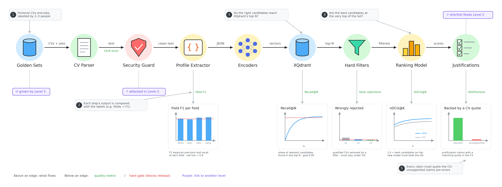

# Evaluation level 1: Pipeline 1 parts

Each step of the screening pipeline gets its own score, so when something breaks we know exactly where.

- **Golden sets:** fake CVs and jobs labelled by 2–3 people. These are the "right answers".
- **CV Parser:** did we read the text correctly? (OCR error)
- **Profile Extractor:** are the extracted skills, experience, education and languages right? (field F1, aim for 0.9 or more)
- **XQdrant:** do the right candidates make it into the first list? (Recall@N, aim for 0.95)
- **Hard Filters:** how many good candidates were wrongly thrown out? (must stay under 5%)
- **Ranking Model:** are the best candidates at the very top? (nDCG@K; a new version must beat the old one)
- **Justifications:** is every claim backed by a real quote from the CV? Unsupported claims count as errors.
- **Links (purple tags):** the Security Guard is attacked in Level 3, the shortlist feeds Level 2, and the golden sets grow from Level 5.
