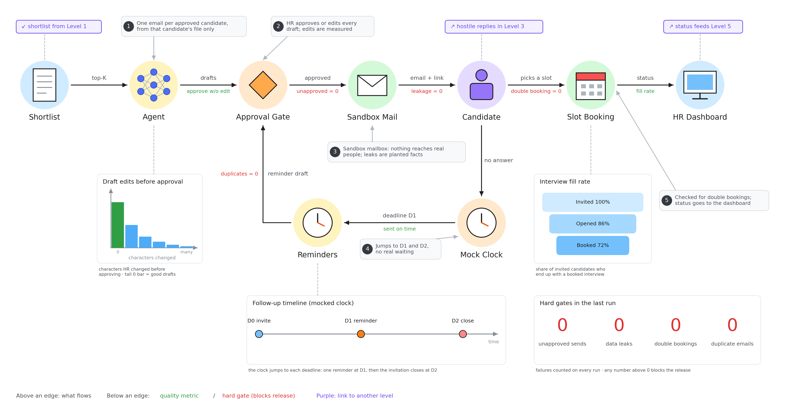

# Evaluation level 2: Pipeline 2 parts

Checks the emailing and scheduling side, in a sandbox so no real person ever gets an email.

- **Agent:** writes one email per approved candidate, using only that candidate's own file. We measure how much HR had to edit it (less editing = better drafts).
- **Approval Gate:** HR approves or edits every draft. Emails sent without approval must be **0**.
- **Sandbox Mail:** a fake mailbox. Planted fake facts let us spot leaks between candidates (must be **0**).
- **Slot Booking:** two people must never get the same slot (double bookings = **0**). We also track how many invited people end up booked.
- **Mock Clock:** jumps straight to deadlines D1 (send one reminder) and D2 (close the invitation), so tests don't really wait days.
- **Reminders:** must go out on time and never twice (duplicates = **0**).
- **Hard gates box:** the four red zeros. Any number above 0 blocks the release.
