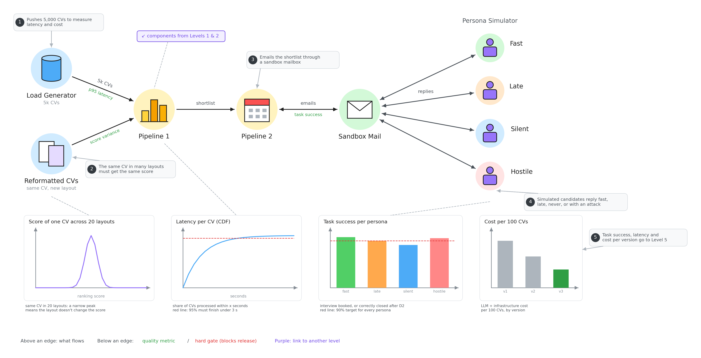

# Evaluation level 4: end to end & system

Both pipelines together, like real life, at real volume.

- **Load generator:** pushes 5,000 CVs to measure speed and cost. 95% of CVs must finish in under 3 seconds.
- **Reformatted CVs:** the same CV in many layouts must get the same score (a narrow peak on the chart = good).
- **Pipeline 1 → Pipeline 2 → Sandbox Mail:** the shortlist is emailed through a fake mailbox.
- **Persona simulator:** fake candidates reply fast, late, never, or with an attack.
- **Task success:** did each persona end up booked, or correctly closed after the last deadline? The target is 90% for every persona.
- **Cost per 100 CVs:** AI plus server cost, compared version by version.
- Success, speed and cost for each version go to Level 5.
