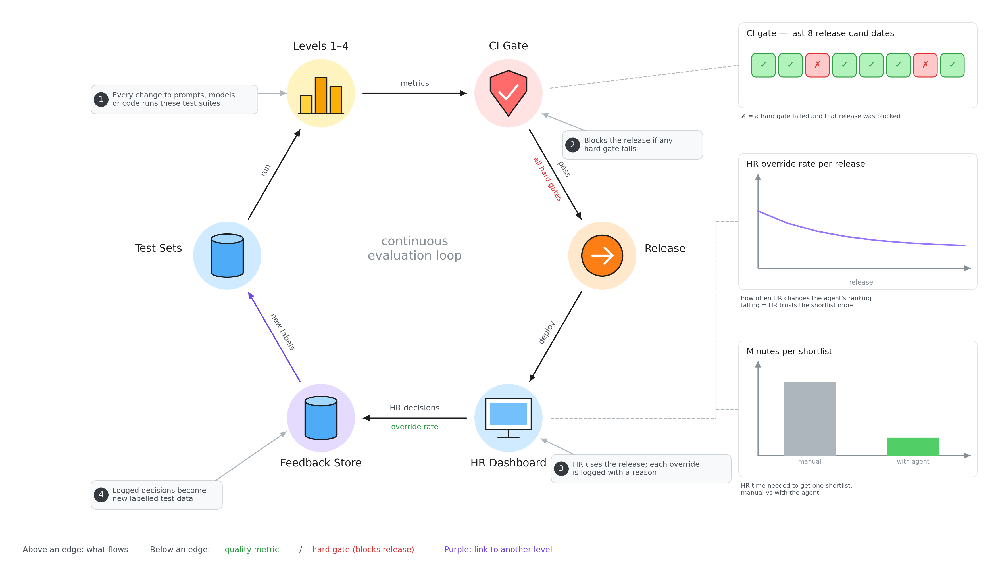

# Evaluation level 5: humans & release

The loop that keeps the agent improving after it ships.

- **Levels 1–4:** every change to a prompt, model or code runs all the tests.
- **CI Gate:** blocks the release if any must-pass rule fails (the ✗ boxes are blocked releases).
- **Release → HR dashboard:** HR uses the new version. Each time HR overrides the ranking, they give a reason, and it is logged.
- **Feedback store:** logged HR decisions become new labelled test data, and the loop starts again.
- **Override rate:** how often HR changes the agent's ranking. A falling line means HR trusts the shortlist more.
- **Minutes per shortlist:** HR time with the agent vs doing it by hand.
