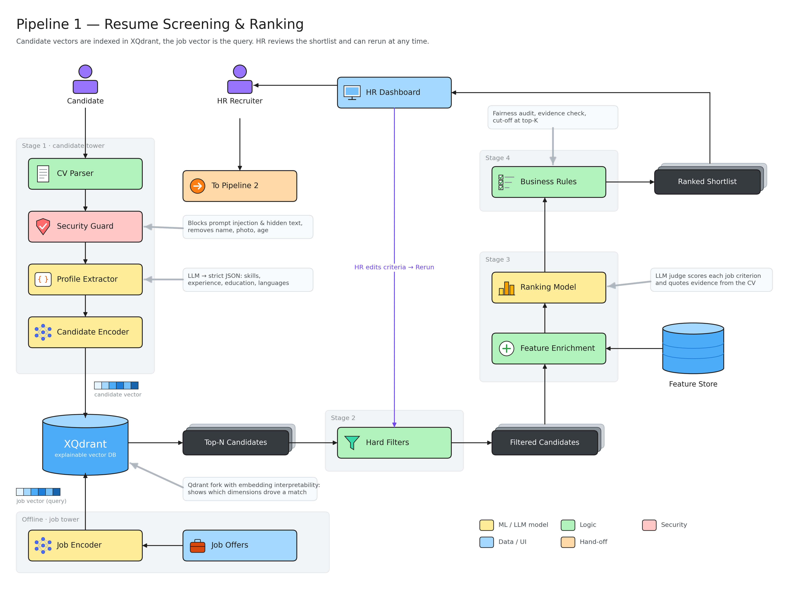

# Pipeline 1: resume screening & ranking

How a pile of CVs becomes a short, ranked list that HR can trust.

- **Candidate side (stage 1):** a CV is read (CV Parser), cleaned (Security Guard removes hidden tricks and personal details like name, photo, age), turned into structured facts (Profile Extractor: skills, experience, education, languages), then turned into a list of numbers (Candidate Encoder).
- **Job side (offline):** each job offer goes through the Job Encoder too, so jobs and CVs are numbers in the same space and can be compared.
- **XQdrant:** our search database. The job is the question, the CVs are the answers. It returns the closest CVs (top N) and can say *which* parts drove a match.
- **Stage 2, Hard Filters:** removes anyone missing a must-have (e.g. a required language).
- **Stage 3, Ranking Model:** an AI judge scores each CV against every job criterion and quotes the CV as proof. Extra facts come from the Feature Store.
- **Stage 4, Business Rules:** checks fairness, checks every quote really is in the CV, keeps only the top K.
- **HR stays in charge:** the shortlist appears on the HR dashboard. HR can change the criteria and rerun at any time, then hands the shortlist to Pipeline 2.
