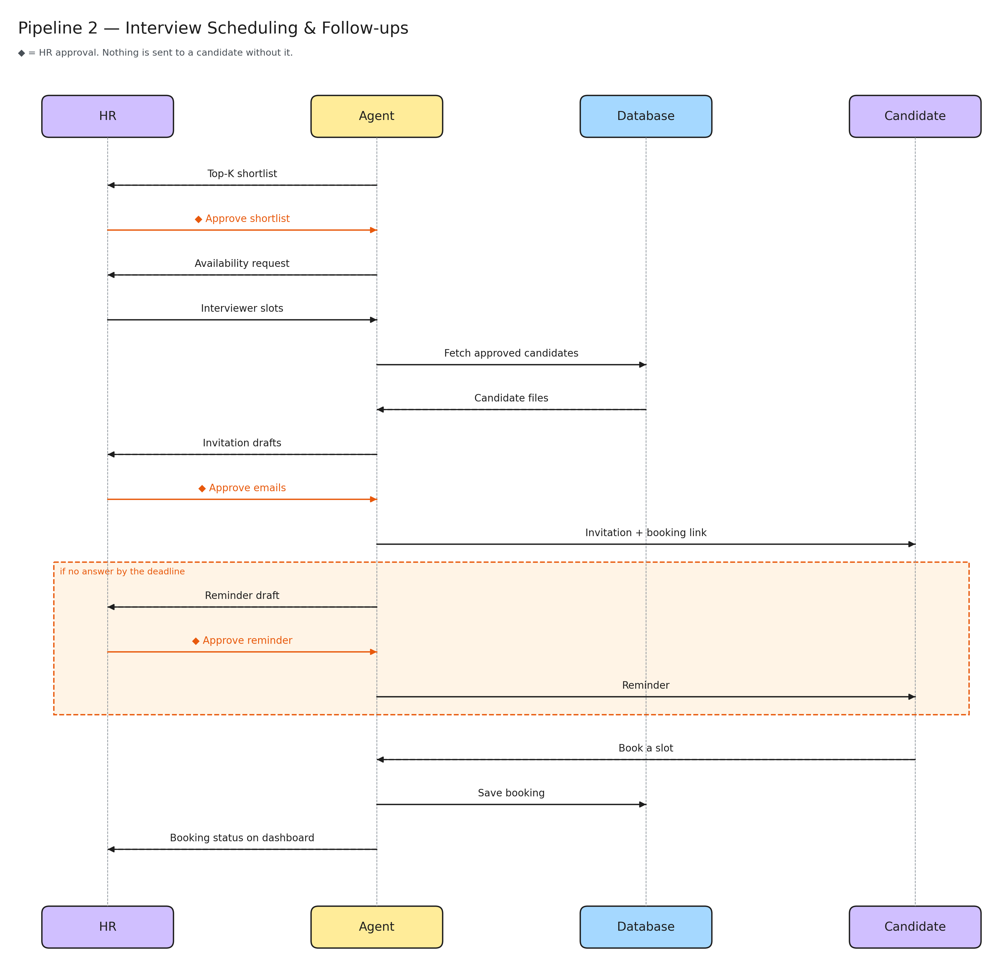

# Pipeline 2: interview scheduling & follow-ups

What happens after the shortlist: inviting candidates and booking interviews. Read it top to bottom, like a chat between four people.

- **The rule:** each orange ◆ is an HR approval. Nothing reaches a candidate without one.
- **Step 1:** the agent sends HR the shortlist, and HR approves it.
- **Step 2:** the agent asks HR when the interviewers are free, and HR gives time slots.
- **Step 3:** the agent pulls the approved candidates' files from the database and writes draft invitation emails.
- **Step 4:** HR approves the emails, then each candidate gets an invitation with a booking link.
- **No answer?** (orange box) after a deadline the agent drafts a reminder, HR approves it, and it is sent.
- **Booking:** the candidate picks a slot, the agent saves it, and HR sees the status on the dashboard.
