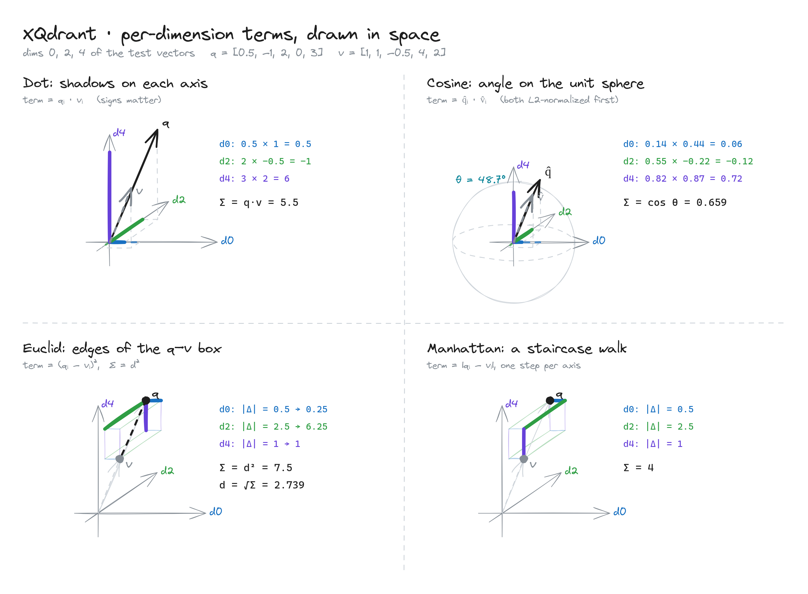

# XQdrant: what a per-dimension term means

A match score is a sum of small pieces, one per dimension. This picture shows what one piece looks like for each kind of score. It uses only 2 of the 5 dimensions (d2 and d4) of two test vectors, q and v.

- **Dot product:** each piece is a "shadow" of v on q. If v points away from q on a dimension, the piece is negative. Sum = 5.
- **Cosine:** the same shadows, but both arrows are first scaled to length 1, so only direction counts, not size. Sum = cos θ = 0.67.
- **Euclidean:** each piece is the square of the gap on one axis (Pythagoras). The biggest square is the dimension that pushes q and v furthest apart. Sum = distance² = 7.25.
- **Manhattan:** each piece is one leg of a walk along the grid, like city blocks. Sum = walk length = 3.5.
