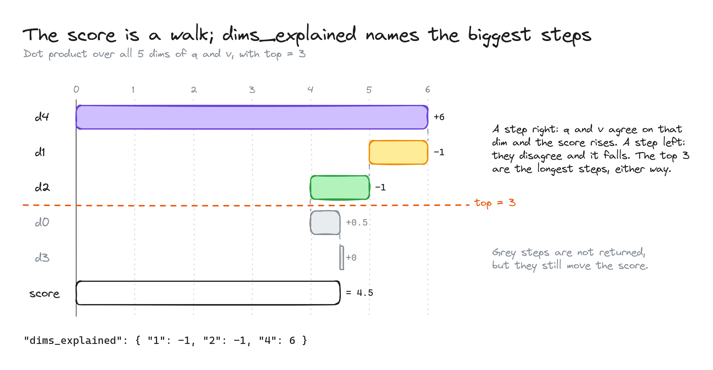

# XQdrant: the score as a walk

How `dims_explained` picks which dimensions to show.

- The score is built step by step, one dimension at a time.
- **Step right:** q and v agree on that dimension, so the score goes up (d4: +6).
- **Step left:** they disagree, so the score goes down (d1: −1, d2: −1).
- **top = 3:** the three biggest steps, up or down, are returned as the explanation.
- **Grey steps** (d0, d3) are not returned, but they still count in the final score (4.5).
- **Result:** `"dims_explained": { "1": -1, "2": -1, "4": 6 }`
