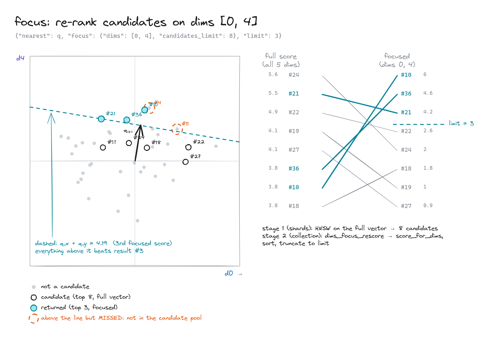

# XQdrant: focus search

Ranking on only the dimensions you care about (here d0 and d4).

- **Step 1:** a normal search on all 5 dimensions picks 8 candidates (circles).
- **Step 2:** those 8 are flattened onto the d0–d4 plane and scored by how far each one reaches in q's direction.
- **Step 3:** the 3 that reach furthest are returned (filled and numbered).
- **Dashed line:** everything on the same line has the same score. Anything above it beats result 3.
- **"Missed" point:** it would have scored well but was never in the first 8. Raise `candidates_limit` to catch points like it.
