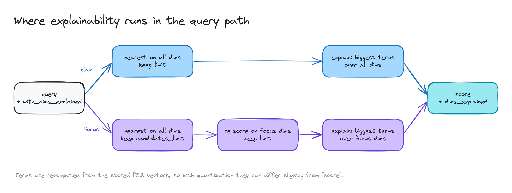

# XQdrant: where explainability runs

Where the explanation is computed during a search.

- **Plain path (blue):** find the nearest results on all dimensions and keep `limit` of them, then explain each one with its biggest pieces across all dimensions.
- **Focus path (purple):** find nearest on all dimensions, keep `candidates_limit` of them, re-score them on the focus dimensions only and keep `limit`, then explain using only the focus dimensions.
- **Output:** both paths return the score plus `dims_explained`.
- **Note:** the pieces are recomputed from the full-precision stored vectors. If the index uses compression (quantization), they can differ a little from the score.
